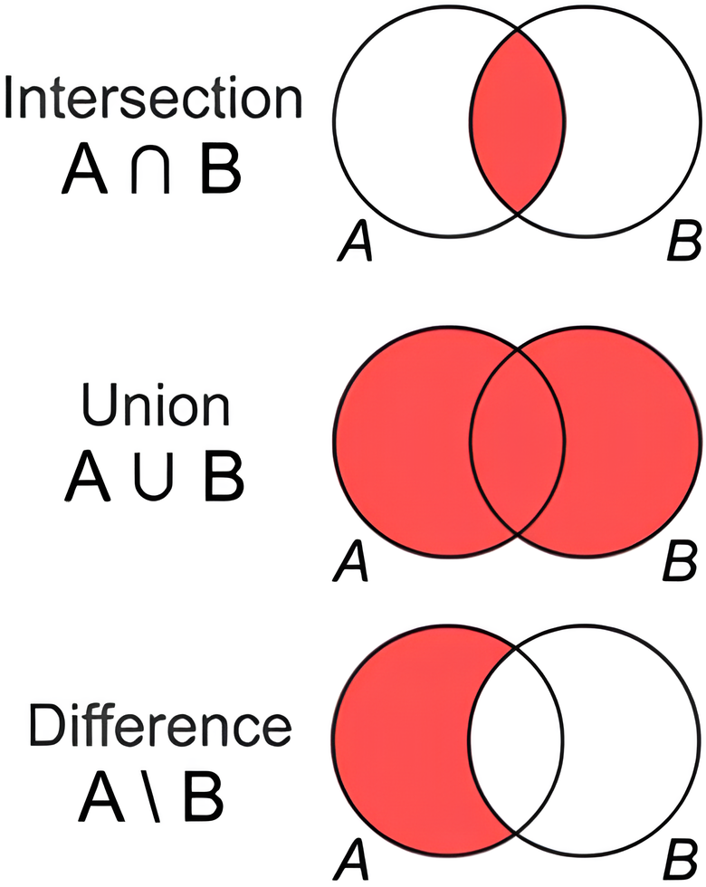
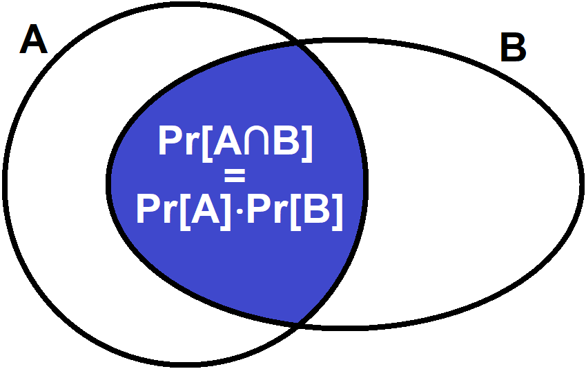
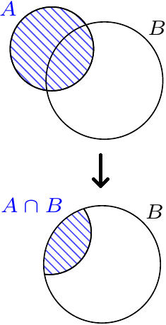
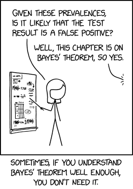
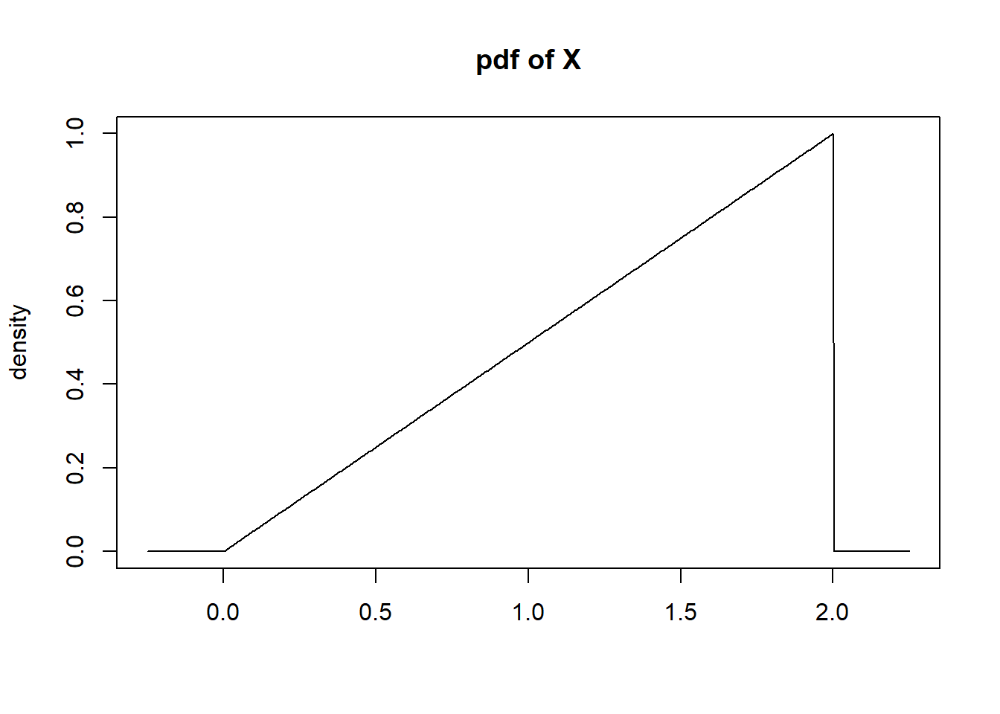
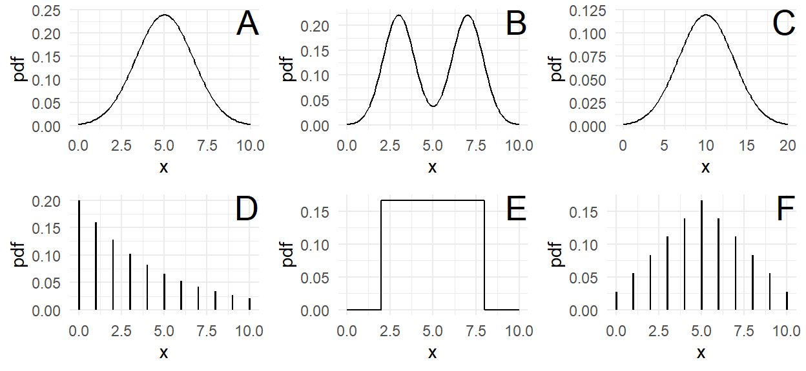
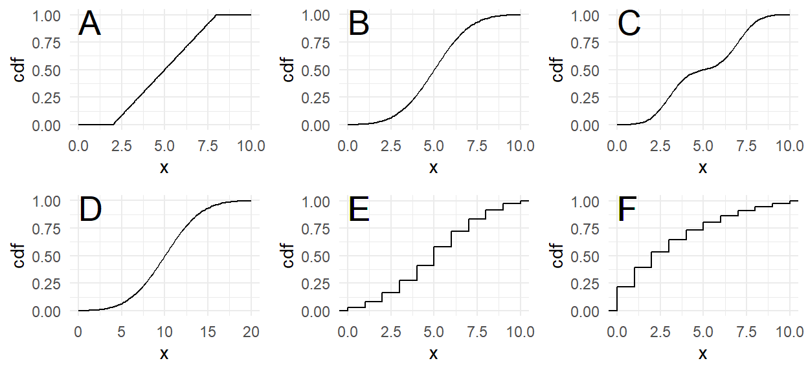

```{r setup,include=F}
knitr::opts_chunk$set(echo=F,fig.align='center',dev='svg')
library(tidyverse)
library(patchwork)
source("https://bwu62.github.io/stat240-revamp/ggplot_theme_options.R")
```


## Concepts

- Probability theory
- Random variables
- Independence
- Conditional probability
- Bayes' rule
- Distributions (PMF/PDF, CDF, inverse CDF)
- Expectation & variance
- Law of large numbers
- List of 340 RVs
- Covariance, correlation


## Probability review


:::{.fragment .no-fade-in .semi-fade-out data-fragment-index=1}

Suppose you have some **random process**, e.g. an experiment.

- An **outcome** is something that can be observed to happen,
- The set of **all possible outcomes** is denoted $\Omega$
- Subsets $E\subseteq\Omega$, consisting of zero or more outcomes, are called **events**
:::

:::{.fragment data-fragment-index=1}
Examples:

- For flipping coins, $\Omega=\{H,T\}$, event of "heads" $=\{H\}$, event of "tails" $=\{T\}$

- For rolling 6-sided die, $\Omega=\{1,2,3,4,5,6\}$. Some examples of events:
  - event: "getting a 6" $=\{6\}$
  - event: "getting no more than 3" $=\{1,2,3\}$, etc.

- For measuring physical dimensions, e.g. masses or lengths, $\Omega=[0,\infty)$
:::

## Event operations

:::{.fragment .no-fade-in .semi-fade-out data-fragment-index=1}

For two events $A,B\subseteq\Omega$,

- The **intersection** $A\cap B$ is the set of all outcomes **in both $A,B$**, i.e. their overlap
  - If intersection is empty, they are **disjoint** or **mutually exclusive**
- The **union** $A\cup B$ is the set of all outcomes **in either $A,B$** or both, i.e. combining them
- The **set difference** $A\backslash B$ is the set of outcomes **in A but not B**

{.absolute style="z-index:-1;" right=30 top=300 height="330"}
:::

:::::::{.fragment .fade-in data-fragment-index=1}

:::::: {.columns}

::::: {.column width="66%"}

Exercise: roll a 6-sided die; let $A=$ "even", $B=$ "at least 3"

:::: {.columns}

::: {.column width="55%"}

- $\Omega=\,$[$?$]{.fragment .fade-out style="position:absolute" data-fragment-index=2}
[$\{1,2,3,4,5,6\}$]{.fragment .fade-in style="position:absolute" data-fragment-index=2}
- $A=\,$[$?$]{.fragment .fade-out style="position:absolute" data-fragment-index=2}
[$\{2,4,6\}$]{.fragment .fade-in style="position:absolute" data-fragment-index=2}
- $B=\,$[$?$]{.fragment .fade-out style="position:absolute" data-fragment-index=2}
[$\{3,4,5,6\}$]{.fragment  .fade-in style="position:absolute" data-fragment-index=2}
- $A\cup B=\,$[$?$]{.fragment .fade-out style="position:absolute" data-fragment-index=2}
[$\{2,3,4,5,6\}$]{.fragment  .fade-in style="position:absolute" data-fragment-index=2}

:::

::: {.column width="45%"}

- $A\cap B=\,$[$?$]{.fragment .fade-out style="position:absolute" data-fragment-index=2}
[$\{4,6\}$]{.fragment  .fade-in style="position:absolute" data-fragment-index=2}
- $A\backslash B=\,$[$?$]{.fragment .fade-out style="position:absolute" data-fragment-index=2}
[$\{2\}$]{.fragment  .fade-in style="position:absolute" data-fragment-index=2}
- $B\backslash A=\,$[$?$]{.fragment .fade-out style="position:absolute" data-fragment-index=2}
[$\{3,5\}$]{.fragment  .fade-in style="position:absolute" data-fragment-index=2}
- $\Omega\backslash(A\cup B)=\,$[$?$]{.fragment .fade-out style="position:absolute" data-fragment-index=2}
[$\{1\}$]{.fragment  .fade-in style="position:absolute" data-fragment-index=2}


:::

::::

:::::

::::: {.column width="40%"}

:::::

::::::

:::::::


## Venn in the wild

<center>{height="550"}</center>

<small>source: <http://redd.it/1n5dulo/></small>


## Probability function

:::{.fragment .no-fade-in .semi-fade-out data-fragment-index=1}
A **probability function** $\pr$ assigns real numbers to events, following these axioms:

1. Probability is nonnegative, i.e. $\p E\ge0$ for any event $E$
2. Probability of all outcomes is 1, i.e. $\p\Omega=1$
3. Probability of union of disjoint events is the sum of probability of each,  
   i.e. if $E_1\cap E_2=\emptyset$, then $\p{E_1\cup E_2}=\p{E_1}+\p{E_2}$
:::

:::{.fragment .fade-in-then-semi-out data-fragment-index=1}
Together, these imply the following corollaries:

1. Probability is always between $[0,1]$
2. Probability of the **complement** (opposite) event $\p{E'}=1-\p E$
3. In general, for any events $E_1,E_2$, probability of their union:  
   $\p{E_1\cup E_2}=\p{E_1}+\p{E_2}-\p{E_1\cap E_2}$
:::

:::{.fragment}
Exercise: suppose in CityTown, 70% of residents have a car, 40% have a bike, and 20% have both. How many have either a car OR a bike? How many have neither? [**Ans: 90%, 10%**]{.fragment}
:::


## Independence

:::{.fragment .no-fade-in .semi-fade-out data-fragment-index=1}
Two events $A,B$ are **independent** if $\p{A\cap B}=\p A\cdot\p B$, which formalizes that knowing one event occurred gives no additional information about the other.
:::

::::: {.columns}

:::: {.column width="70%"}

:::{.fragment .fade-in-then-semi-out data-fragment-index=1}
Example: suppose a 60-person class has these students:

||Freshmen|Sophomores|Juniors|
|-:|:-:|:-:|:-:|
|Male|20|14|6|
|Female|10|6|4|
:::

:::{.fragment .fade-in-then-semi-out}
Randomly draw a student from the class, and define:

 - $A=$ "student is male"
 - $B=$ "student is freshman"
 - $C=$ "student is sophomore"

:::

::::

::::{.column width="30%"}

:::{.fragment .no-fade-in .semi-fade-out data-fragment-index=1}
{.absolute style="z-index:-1;" right=20 top=200 height="210"}
:::

::::

:::::

:::{.fragment}
$A,B$ independent since $~\p{A\cap B}=\frac{20}{60}=\frac13=\frac23\cdot\frac12=\frac{40}{60}\cdot\frac{30}{60}=\p A\cdot\p B$  
$A,C$ dependent since $~~\;\,\p{A\cap C}=\frac{14}{60}=\!\frac{7}{30}\!\ne\frac23\cdot\frac13=\frac{40}{60}\cdot\frac{20}{60}=\p A\cdot\p C$  
Exercise: Are $B,C$ independent? If not, is there a better phrase to describe them?
:::


## Conditional probability

:::{.fragment .no-fade-in .semi-fade-out data-fragment-index=1}
The **conditional probability** of $A$ given $B$, written $\p{A\mid B}$, refers to the probability of $A$ occurring **assuming** $B$ *already* occurred. It's defined:
:::

::::: {.columns}

:::: {.column width="75%"}

:::{.fragment .no-fade-in .semi-fade-out data-fragment-index=1 style="margin:-.5em 0 -.5em"}
$$\p{A\mid B}=\frac{\p{A\cap B}}{\p B}$$
:::

:::{.fragment .fade-in-then-semi-out data-fragment-index=1}
Example: roll a 6-sided die again; let $A=$ "get 2", $B=$ "get even"

Then $~\displaystyle\p{A\mid B}=\frac{\p{A\cap B}}{\p B}=\frac{\p{\{2\}}}{\p{\{2,4,6\}}}=\frac13$ ,  

i.e. if we know the result is even, then there's a 1 in 3 chance it's a 2.
:::

::::

::::{.column width="25%"}

:::{.fragment .no-fade-in .semi-fade-out data-fragment-index=1}
{.absolute style="z-index:-1;" right=50 top=140 height="350"}
:::

::::

:::{.fragment .fade-in-then-semi-out style="margin-top:.7em"}
Note however: $~\displaystyle\p{B\mid A}=\frac{\p{A\cap B}}{\p A}=\frac{\p{\{2\}}}{\p{\{2\}}}=1$ , since 2 is definitely even
:::

:::{.fragment}
Also note: $~\displaystyle1-\p{A\mid B}=\frac{\p B}{\p B}-\frac{\p{A\cap B}}{\p B}=\frac{\p{A'\cap B}}{\p B}=\p{A'\mid B}$
:::

:::::


## Conditional probability (cont.)

:::{.fragment .no-fade-in .semi-fade-out data-fragment-index=1}
Consider a few special cases for events $A,B$:

1. $A,B$ independent, then $\displaystyle\p{A\mid B}=\frac{\p{A\cap B}}{\p B}=\frac{\p A\cdot\p B}{\p B}=\p A$  
   i.e. knowing $B$ occurred gives no additional information about $A$
:::

:::{.fragment .fade-in-then-semi-out data-fragment-index=1}
2. $A,B$ mutually exclusive, then $\displaystyle\p{A\mid B}=\frac{\p{A\cap B}}{\p B}=\frac0{\p B}=0$
:::

:::{.fragment .fade-in-then-semi-out}
3. $B\subseteq A$, then $\displaystyle\p{A\mid B}=\frac{\p{A\cap B}}{\p B}=\frac{\p B}{\p B}=1$, as seen previously
:::

:::{.fragment .fade-in-then-semi-out}
Exercise: a family with 2 kids has at least 1 boy; what's the probability they have 2 boys?
:::

:::{.fragment}
**Ans:** $\displaystyle\p{2B\mid\;\ge\!1B}=\frac{\p{2B\;\cap\ge\!1B}}{\p{\ge\!1B}}=\frac{\p{\{BB\}}}{\p{\{BB,BG,GB\}}}=\frac{1/4}{3/4}=\frac13$
:::


## Importance of conditional probability

<center>{height="550"}</center>

<small>source: <https://xkcd.com/795/></small>


## Bayes' rule

:::{.fragment .no-fade-in .semi-fade-out data-fragment-index=1}
Rearranging the conditional probability formula, we get this equivalence:

$$\p{A\cap B}=\p{A\mid B}\p B=\p{B\mid A}\p A$$
:::

:::{.fragment .fade-in-then-semi-out data-fragment-index=1}
Rearranging again, we have $~~\displaystyle\p{A\mid B}=\frac{\p{B\mid A}\p A}{\p B}$
:::

:::{.fragment .fade-in-then-semi-out style="margin-top:1em"}
This is the simplest form of Bayes' rule. Often, the denominator is expanded further:
$$\p B=\p{B\cap A}+\p{B\cap A'}=\p{B\mid A}\p{A}+\p{B\mid A'}\p{A'}$$
:::

:::{.fragment style="margin:1.5em 0 1.5em"}
The full form of Bayes' rule: $~~\displaystyle\p{A\mid B}=\frac{\p{B\mid A}\p A}{\p{B\mid A}\p{A}+\p{B\mid A'}\p{A'}}$

But why? Bayes' rule lets you **flip a conditional**,  
i.e. you have $B$ given $A$ but you want $A$ given $B$
:::


## Bayes' rule exercise

:::{.fragment .no-fade-in .semi-fade-out data-fragment-index=1}
Suppose a genetic condition occurs in roughly 1 out of 800 individuals (*prevalence*). A simple saliva test is available. If a person has the gene, the test is positive with 97% probability (*sensitivity*). If a person does not have the gene, a false positive occurs with 4% probability (*false positive rate*). A random person takes the test and gets positive, what's the probability they have the genetic condition?
:::

:::{.fragment .fade-in-then-semi-out data-fragment-index=1 style="margin-top:30px"}
Hint: let $G=$ "have genetic condition", $P=$ "test is positive", we want $~\p{G\mid P}$

$$
\p{G\mid P}=\frac{\p{P\mid G}\p G}{\p{P\mid G}\p{G}+\p{P\mid G'}\p{G'}}
$$
:::

::::{.fragment}
**Ans:**

:::{style="margin-top:-40px"}
$$
~~~~~~~~~~~~~~~~~~~~~~~~=\frac{(.97)(1/800)}{(.97)(1/800)+(.04)(799/800)}\approx 0.0295
$$
:::

A positive test has about 3% chance of being correct, due to the false positive rate being much higher than the rarity of the disease.
::::


## Bayes' rule

<center>{height="550"}</center>

<small>source: <https://xkcd.com/2545/></small>


## Random variables, PMF/PDFs

:::{.fragment .no-fade-in .semi-fade-out data-fragment-index=1}
A **random variable** (RV) $X$ is a sample space $\Omega$ with a probability function $\pr$ that together represent outcomes of a random process and their associated probabilities. Two general categories of RVs: **discrete** & **continuous**.
:::

:::{.fragment .fade-in-then-semi-out data-fragment-index=1}
- **Discrete** RVs, where all outcomes can be listed one at a time (list may be infinite)
  - For discrete RVs, probability defined by **probability mass function** (PMF)
  - Example: binomial

- **Continuous** RVs, where outcomes can be any value in a continuous range
  - For continuous RVs, probability defined by **probability density function** (PDF)
  - Example: normal
:::

:::{.fragment}
Note:

- PMFs output actual probabilities, PDFs output densities which are NOT probability (probabilities on PDFs are always areas of regions under the curve)
- PMFs and PDFs must satisfy all axioms of probability
:::


## RV examples

:::{.fragment .no-fade-in .semi-fade-out data-fragment-index=1}
Discrete example: suppose $X$ has the following PMF:

|$k$|0|1|2|3|4|
|:-:|:-:|:-:|:-:|:-:|:-:|
|$\p{X=k}$|0.10|0.15|0.20|0.30|0.25|

Exercises: 1. Check probability axioms are satisfied. 2. What's the probability of getting an even result? 3. Can you make a plot of this PMF?
:::


::::: {.columns}

:::: {.column width="55%"}

:::{.fragment data-fragment-index=1 style="margin-top:1.5em"}
Continuous example: suppose $X$ outputs a real number in $[0,2]$ with PDF $f(x)=x/2$.

Exercises: 1. Again check the probability axioms. 2. What's the probability of getting exactly 1? How about the probability of getting $>$ 0.5?  
3. Again, can you plot this PDF yourself?
:::

::::

::::{.column width="45%"}

:::{.fragment data-fragment-index=1}
{.absolute style="z-index:-1;" right=0 top=300 height="350"}
:::

::::

:::::


## Cumulative distribution functions (CDFs)

:::{.fragment .no-fade-in .semi-fade-out data-fragment-index=1}
For a RV $X$ with a certain PMF/PDF, the **cumulative distribution function** (CDF) is defined 

$$F_X(x)=\p{X\le x}$$
:::

[If $F_X(x)=p$, then $x$ is the $p$-th **percentile** of $X$, i.e. the left-side integrated area under the PMF/PDF function from $-\infty$ to $x$ equals $p$. &nbsp; (Note: $X$ is the RV, $x$ is the point!)]{.fragment .no-fade-in .semi-fade-out data-fragment-index=1} &nbsp; [Examples:]{.fragment .fade-in data-fragment-index=1}

:::{.fragment data-fragment-index=1}
```{r,fig.width=9,fig.height=4.5}
p1 = ggplot() + geom_function(fun=dnorm,xlim=c(-3,3)) +
  scale_x_continuous(breaks=-4:4, expand=0) +
  scale_y_continuous(breaks=0:4/10, expand=0, limits=c(0,.4)) + 
  labs(y="density",title="Normal(0,1) PDF")
p2 = ggplot() + geom_function(fun=pnorm,xlim=c(-3,3)) + 
  scale_x_continuous(breaks=-4:4, expand=0) +
  scale_y_continuous(breaks=0:5/5, expand=c(0,.01)) + 
  labs(y="cumulative probability",title="Normal(0,1) CDF")
p3 = tibble(x=0:10, y=dbinom(x,10,0.5)) %>% 
ggplot(aes(x,y)) + geom_col() +
  scale_x_continuous(breaks=0:10, expand=0) +
  scale_y_continuous(breaks=0:5/20, limits=c(0,.25), minor_breaks=NULL, expand=0) +
  labs(y="probability",title="Binomial(10,0.5) PMF")
p4 = ggplot() + geom_function(fun=\(x)pbinom(x,10,.5), xlim=c(0,10), n=1e4) +
  scale_x_continuous(breaks=0:10, expand=0) +
  scale_y_continuous(breaks=0:5/5, expand=c(0,.01)) +
  labs(y="cumulative probability", title="Binomial(10, 0.5) CDF")
(p1+p3)/(p2+p4)
```
:::

## CDF (cont.)

:::{.fragment .no-fade-in .semi-fade-out data-fragment-index=1}
Any CDF $F(x)$ always satisfies these properties:

1. $F(-\infty)=0$, $F(\infty)=1$
2. $F$ is **monotone non-decreasing** from left to right, i.e. if $a\le b$, then $F(a)\le F(b)$
3. a. If the RV is continuous, then $F$ is continuous
   b. If the RV is discrete, then $F$ has a "staircase" shape, with steps beginning at each possible outcome and having a height equal to that outcome's probability
:::

:::{.fragment data-fragment-index=1 style="margin-top:1em"}
Additionally, note that the CDF can be used to calculate probabilities of events:

$$
\p{a<X\le b}=F(b)-F(a)
$$

Also recall for discrete variables, $<$ vs $\le$ and $>$ vs $\ge$ matters, but for continuous variables these are interchangeable, since probability of any single outcome $\p{X=x}=0$
:::


## PMF/PDF, CDF exercise

Match the following densities to their corresponding CDFs:

<center>{height="260"}</center>
<center>{height="260"}</center>

:::{.fragment}
Densities A-F match in order: B, C, D, F, A, E
:::


## Inverse CDF (quantile)

:::{.fragment .no-fade-in .semi-fade-out data-fragment-index=1}
The **inverse CDF** $F^{-1}$, also called the **quantile** function, inverts the CDF, i.e. does the "opposite". Given a probability $p$, it finds the **smallest $x$** such that $\p{X\le x}\ge p$,  
i.e. it finds the smallest outcome $x$ with at least $p$ area to the left.
:::

:::{.fragment .fade-in-then-semi-out data-fragment-index=1 style="margin-top:1em"}
Note inverse is the opposite function that "undoes" it, NOT the reciprocal.  
Exercise: What are the inverses of: 1. $f(x)\!=\!x\!+\!1~$, 2. $f(x)\!=\!x^2~$, 3. $f(x)\!=\!e^x~$?
:::

:::{.fragment .fade-in-then-semi-out style="margin-top:1em"}
The quantile function, opposite to the CDF, is defined on $[0,1]$ and outputs in $\Omega$. Similar to the CDF, it's continuous for continuous RVs and staircase-like for discrete RVs.
:::

:::{.fragment style="margin-top:1em"}
- In R, PMF/PDFs are the `d...()` functions (d for density), e.g. `dnorm()`,
- CDFs are the `p...()` functions (p for percentile), e.g. `pnorm()`, 
- and inverse CDFs are the `q...()` functions (q for quantile), e.g. `qnorm()`.

Shiny demo: <https://www.statlab.wisc.edu/shiny/bwu62/340/pdf-cdf/> &nbsp; <small>([*source*](https://github.com/bwu62/shinys/blob/master/340/pdf-cdf/app.R))</small>
:::


## Expectation

<style>#expectation code.sourceCode.r{overflow-x:hidden}</style>

:::{.fragment .no-fade-in .semi-fade-out data-fragment-index=1}
The **expected value** (EV) $~\displaystyle\e X\!=\!\sum_x\,x\cdot\p{X=x}~$ or $\mu$ is the theoretical mean of $X$

In general $~\displaystyle\e{f(X)}\!=\!\sum_x\,f(x)\cdot\p{X=x}~$ gives the expectation of function $f$ of $X$
:::

:::{.fragment .fade-in-then-semi-out data-fragment-index=1 style="margin-top:1em"}
If $\e X$ exists, then the average of a large sample of independent observations will converge to it by the **Law of Large Numbers** (LLN). In other words, $\bar x\to\e X$ as $n\to\infty$

Exercise: show EV of fair $n$-sided die with $1,2,...,n$ on each side is $(n+1)/2$
:::

:::::{.fragment style="margin-top:1em"}

:::: {.columns}

::: {.column width="46%"}

```{r mean-lln,eval=F,echo=T}
# Example: show convergence of sample mean
options(scipen=1) # suppress scientific notation
set.seed(1) # set seed for repeatability
n = 1e5 # roll 6-sided die (EV=3.5) n times
rolls = sample(6, size=n, replace=TRUE)
m = cumsum(rolls)/seq_along(rolls)
tibble(x=2:n,y=m[-1]) %>% ggplot(aes(x,y)) +
  geom_hline(yintercept=3.5,color="red") + 
  geom_line() + scale_x_log10() + 
  scale_y_continuous(limits=c(2.5,4.5)) + 
  theme_bw(base_size=18) + labs(x="n",y="mean",
  title="Running mean of 6-sided die rolls")
```

:::

:::{.column width="54%"}

```{r,ref.label='mean-lln',eval=T,echo=F,out.width="100%"}
```

:::

::::

:::::


## Variance

<style>#variance code.sourceCode.r{overflow-x:hidden}</style>

:::{.fragment .no-fade-in .semi-fade-out data-fragment-index=1}
The **variance** $~\displaystyle\v X=\e{(X-\mu)^2}=\sum_x\,(x-\mu)^2\cdot \p{X=x}~$ or $\sigma^2$ is the mean squared distance of observations from $\mu$. Its square root is called **standard deviation** or $\sigma$.
:::

:::{.fragment .fade-in-then-semi-out data-fragment-index=1 style="margin-top:1.5em"}
Since this is also the average of a quantity, if it exists then by the LLN the sample variance $\displaystyle S^2=\frac1{n-1}\sum_{i=1}^n(x_i-\bar x)^2$ converges to it, i.e. $S^2\to\sigma^2$ as $n\to\infty$.  
Exercise: show variance of fair 6-sided die $=35/12\approx2.92$
:::

:::::{.fragment style="margin-top:1em"}

:::: {.columns}

::: {.column width="46%"}

```{r var-lln,eval=F,echo=T}
# Example: show convergence of sample variance
set.seed(3) # set seed for repeatability
n = 1e5 # roll 6-sided die n times
rolls = sample(6, size=n, replace=TRUE)
m = cumsum(rolls)/seq_along(rolls)
v = cumsum((rolls-m)^2)/(seq_along(rolls)-1)
tibble(x=2:n,y=v[-1]) %>% ggplot(aes(x,y)) +
  geom_hline(yintercept=35/12,color="red") + 
  geom_line() + scale_x_log10() + 
  scale_y_continuous(limits=c(.8,5)) + 
  theme_bw(base_size=18) + labs(x="n",y="mean",
  title="Running variance of 6-sided die rolls")
```

:::

:::{.column width="54%"}

```{r,ref.label='var-lln',eval=T,echo=F,out.width="100%"}
```

:::

::::

:::::


## Continuous E, Var

:::{.fragment .no-fade-in .semi-fade-out data-fragment-index=1}
For continuous $X$, replace PMF and summation with PDF $f(x)$ and integral

$$
\e X=\intO xf(x)\dx\qquad\v X=\intO (x-\mu)^2f(x)\dx
$$

EX: show for previous example PDF $f(x)\!=\!x/2$ over $[0,2]$ that $\mu\!=\!4/3$, $\sigma^2\!=\!2/9$
:::

:::{.fragment data-fragment-index=1 style="margin-top:1em"}

$$
\begin{aligned}
\e X&=\int_0^2x\left(\frac x2\right)\dx=\frac16x^3\,\bigg|_0^2~~=~\frac43\qquad\qquad\\[6pt]
\v X&=\int_0^2\Big(x-\frac43\Big)^2\!\Big(\frac x2\Big)\dx\\
&=\frac12\int_0^2\Big[x^3-\frac83x^2+\frac{16}9x\Big]\dx\\
&=\frac12\bigg|\frac14x^4-\frac89x^3+\frac89x^2\bigg|_0^2~~=~\frac29
\end{aligned}
$$

:::


## RVs covered in 340

- Discrete:
  - Binomial
    - Special case for $n=1$ called Bernoulli
  - Geometric
  - Poisson
  - Discrete uniform

- Continuous:
  - Normal
  - (Continuous) uniform
  - Exponential


## Binomial$(n,p)$

- Models **number of successes** in $n$ independent trials, each with chance $p$ of success

- Examples: number of heads in flips, number of patients responding to treatment, etc.

- Outcomes: 0, 1, ..., n. &nbsp;&nbsp; Moments: $~\mu=np$, $~\sigma^2=np(1-p)$

- PMF: $~\p{X=k}={n\choose k}p^k(1-p)^{n-k}$

:::: {.columns}

::: {.column width="30%"}

- $n=1$ case called Bernoulli$(p)$


<br/>

Example:

Binomial$(10,0.5)$  
$\mu=5$, $~\sigma\approx1.58$

:::

:::{.column width="70%"}

```{r,out.width="100%",fig.height=5.5}
p1 = tibble(x=0:10, y=dbinom(x,10,0.5)) %>% 
ggplot(aes(x,y)) + geom_col() +
  scale_x_continuous(breaks=0:10, expand=0) +
  scale_y_continuous(breaks=0:5/20, limits=c(0,.25), minor_breaks=NULL, expand=0) +
  labs(y="probability",title="Binomial PMF:  dbinom(x,10,0.5)")
p2 = ggplot() + geom_function(fun=\(x)pbinom(x,10,.5), xlim=c(0,10), n=1e4) +
  scale_x_continuous(breaks=0:10, expand=0) +
  scale_y_continuous(breaks=0:5/5, expand=c(0,.01)) +
  labs(y="cumulative probability", title="Binomial CDF:  pbinom(q,10,0.5)")
p3 = ggplot() + geom_function(fun=\(x)qbinom(x,10,.5), xlim=c(0,1), n=1e4) +
  scale_x_continuous(breaks=0:10/10, expand=c(0,.01)) +
  scale_y_continuous(breaks=0:5*2, expand=0) +
  labs(x="cumulative probability", y="x", title="Binomial quantile function:  qbinom(p,10,0.5)")
set.seed(1)
p4 = tibble(x = rbinom(1000,10,0.5)) %>% ggplot(aes(x)) + 
  geom_histogram(binwidth=1,center=0,color="white",linewidth=2) +
  scale_x_continuous(breaks=0:10, expand=0) + 
  scale_y_continuous(expand=0) + 
  labs(title="Histogram of n=1000 draws:  rbinom(n,10,0.5)")
(p1+p2)/(p3+p4)
```

:::

::::


## Geometric$(p)$

- Models **number of trials _before 1^st^ success_**, each trial independently chance $p$ of success

- Examples: flipping coin until we get heads, number of tries before making a shot, etc.

- Outcomes: 0, 1, 2, ... . &nbsp;&nbsp; Moments: $~\mu=(1-p)/p$, $~\sigma^2=(1-p)/p^2$

- PMF: $~\p{X=k}=p(1-p)^k$ , &nbsp;&nbsp; CDF: $~\p{X\le k}=1-(1-p)^{\lfloor k\rfloor+1}$

:::: {.columns}

::: {.column width="33%"}

- Note: there's a competing definition of "number of trials ***until*** first success, instead of ***before***. We will prefer the ***before*** version!

Example:

Geometric$(0.5)$  
$\mu=1$, $~\sigma\approx1.44$

:::

:::{.column width="67%"}

```{r,out.width="100%",fig.height=5.5}
p1 = tibble(x=0:10, y=dgeom(x,0.5)) %>% 
  ggplot(aes(x,y)) + geom_col() +
  scale_x_continuous(breaks=0:10, expand=0) +
  scale_y_continuous(breaks=0:5/10, limits=c(0,.5), minor_breaks=NULL, expand=0) +
  labs(y="probability",title="Geometric PMF:  dgeom(x,0.5)")
p2 = ggplot() + geom_function(fun=\(x)pgeom(x,.5), xlim=c(0,10), n=1e4) +
  scale_x_continuous(breaks=0:10, expand=0) +
  scale_y_continuous(breaks=0:5/5, expand=c(0,.01)) +
  labs(y="cumulative probability", title="Geometric CDF:  pgeom(q,0.5)")
p3 = ggplot() + geom_function(fun=\(x)qgeom(x,.5), xlim=c(0,1), n=1e4) +
  scale_x_continuous(breaks=0:10/10, expand=c(0,.01)) +
  scale_y_continuous(breaks=0:5*2, expand=c(0,.1)) +
  labs(x="cumulative probability", y="x", title="Geometric quantile function:  qgeom(p,0.5)")
set.seed(1)
p4 = tibble(x = rgeom(1000,0.5)) %>% ggplot(aes(x)) + 
  geom_histogram(binwidth=1,center=0,color="white",linewidth=2) +
  scale_x_continuous(breaks=0:10, expand=0) + 
  scale_y_continuous(expand=0) + 
  labs(title="Histogram of n=1000 draws:  rgeom(n,0.5)")
(p1+p2)/(p3+p4)
```

:::

::::


## Poisson$(\lambda)$

- Models **count of occurrences** when events happen independently with average rate $\lambda$

- Examples: number of fish caught on trip, number of weeds in certain area, etc.

- Outcomes: 0, 1, 2, ... . &nbsp;&nbsp; Moments: $~\mu=\sigma^2=\lambda$

- PMF: $~\p{X=k}=\lambda^ke^{-\lambda}/k!$

:::: {.columns}

::: {.column width="33%"}

- $\lambda$ usually defined over some amount of time/ space/etc & scales with it
- Can be derived from limit of binomial, see: <small>[https://mathcenter.oxford.emory.edu/site/ math117/connectingPoissonAndBinomial](https://mathcenter.oxford.emory.edu/site/math117/connectingPoissonAndBinomial/)</small>

Example: Poisson$(5)$, i.e. something happening on average 5 times per ____

:::

:::{.column width="67%"}

```{r,out.width="100%",fig.height=5.5}
p1 = tibble(x=0:15, y=dpois(x,5)) %>% 
  ggplot(aes(x,y)) + geom_col() +
  scale_x_continuous(breaks=0:15, expand=0) +
  scale_y_continuous(breaks=0:3/20, limits=c(0,.18), minor_breaks=NULL, expand=0) +
  labs(y="probability",title="Poisson PMF:  dpois(x,5)")
p2 = ggplot() + geom_function(fun=\(x)ppois(x,5), xlim=c(0,15), n=1e4) +
  scale_x_continuous(breaks=0:15, expand=0) +
  scale_y_continuous(breaks=0:5/5, expand=c(0,.01)) +
  labs(y="cumulative probability", title="Poisson CDF:  ppois(q,5)")
p3 = ggplot() + geom_function(fun=\(x)qpois(x,.5), xlim=c(0,1), n=1e4) +
  scale_x_continuous(breaks=0:10/10, expand=c(0,.01)) +
  scale_y_continuous(breaks=0:5*2, expand=c(0,.1), limits=c(0,10)) +
  labs(x="cumulative probability", y="x", title="Poisson quantile function:  qpois(p,5)")
set.seed(1)
p4 = tibble(x = rpois(1000,5)) %>% ggplot(aes(x)) + 
  geom_histogram(binwidth=1,center=0,color="white",linewidth=2) +
  scale_x_continuous(breaks=0:15, expand=0) + 
  scale_y_continuous(expand=0) + 
  labs(title="Histogram of n=1000 draws:  rpois(n,5)")
(p1+p2)/(p3+p4)
```

:::

::::


## Discrete uniform$(a,b)$

- Models $n$-sided fair die with integers $a,a\!+\!1,...,b$ on it &nbsp; (note $n=b-a+1$)

- Other examples: lottery draws, seconds value when you check the time, etc.

- Outcomes: $a$, $a\!+\!1$, ..., $b$. &nbsp;&nbsp; Moments: $~\mu=(a+b)/2$, $~\sigma^2=(n^2-1)/12$

- PMF: $~\p{X=k}=1/n$

:::: {.columns}

::: {.column width="33%"}

<br/>

Example:  
Discrete uniform$(1,6)$, i.e. fair 6-sided die roll  
(using `extraDistr` package)

$\mu=3.5$, $~\sigma\approx1.71$
:::

:::{.column width="67%"}

```{r,out.width="100%",fig.height=5.5}
library(extraDistr)
p1 = tibble(x=0:7, y=ddunif(x,1,6)) %>%
  ggplot(aes(x,y)) + geom_col() +
  scale_x_continuous(breaks=0:7, expand=0) +
  scale_y_continuous(breaks=0:3/20, limits=c(0,.18), minor_breaks=NULL, expand=0) +
  labs(y="probability",title="Discrete uniform PMF:  ddunif(x,1,6)")
p2 = ggplot() + geom_function(fun=\(x)pdunif(x,1,6), xlim=c(0,7), n=1e4) +
  scale_x_continuous(breaks=0:7, expand=0) +
  scale_y_continuous(breaks=0:5/5, expand=c(0,.01)) +
  labs(y="cumulative probability", title="Discrete uniform CDF:  pdunif(q,1,6)")
p3 = ggplot() + geom_function(fun=\(x)qdunif(x,1,6), xlim=c(0,1), n=1e4) +
  scale_x_continuous(breaks=0:10/10, expand=c(0,.01)) +
  scale_y_continuous(breaks=1:6, expand=c(0,.1), limits=c(1,6)) +
  labs(x="cumulative probability", y="x", title="Discrete uniform quantile function:  qdunif(p,1,6)")
set.seed(1)
p4 = tibble(x = extraDistr::rdunif(1000,1,6)) %>% ggplot(aes(x)) +
  geom_histogram(binwidth=1,center=0,color="white",linewidth=2) +
  scale_x_continuous(breaks=0:7, expand=0) +
  scale_y_continuous(expand=0) +
  labs(title="Histogram of n=1000 draws:  rdunif(n,1,6)")
(p1+p2)/(p3+p4)
```

:::

::::


## Normal$(\mu,\sigma^2)$

- Most things that are the sum or mean of many smaller independent components are well modeled by the normal (due to the Central Limit Theorem)

- Outcomes: $(-\infty,\infty)$. &nbsp;&nbsp; Moments: $~\mu=\mu$, $~\sigma^2=\sigma^2$

- PDF: $~f(x)=\frac1{\sigma\sqrt{2\pi}}e^{-\frac12\left(\frac{x-\mu}\sigma\right)^2}$

:::: {.columns}

::: {.column width="33%"}

- Note: in 340, we will prefer the parametrization Normal$(\mu,\sigma^2)$ instead of Normal$(\mu,\sigma)$ from 240
- Remember empirical rule: 68/95/99.7% of data within ±1/2/3 SDs

Example:  
Normal$(0,1)$, i.e. the  
standard normal $Z$

:::

:::{.column width="67%"}

```{r,out.width="100%",fig.height=5.5}
p1 = ggplot() + geom_function(fun=dnorm,xlim=c(-3,3)) +
  scale_x_continuous(expand=0) + 
  scale_y_continuous(breaks=0:4/10,limits=c(0,.41),expand=0) +
  labs(y="density",title="Normal PDF:  dnorm(x,0,1)")
p2 = ggplot() + geom_function(fun=pnorm, xlim=c(-3,3)) +
  scale_x_continuous(expand=0) + 
  scale_y_continuous(breaks=0:5/5,limits=c(0,1),expand=0) +
  labs(y="cumulative probability", title="Normal CDF:  pnorm(q,0,1)")
p3 = ggplot() + geom_function(fun=qnorm, xlim=c(0,1),n=1e4) +
  scale_x_continuous(breaks=0:5/5,expand=0) + 
  scale_y_continuous(limits=c(-3,3),expand=0) +
  labs(x="cumulative probability", y="x", title="Normal quantile function:  qnorm(p,0,1)")
set.seed(1)
p4 = tibble(x = rnorm(1000,0,1)) %>% ggplot(aes(x)) +
  geom_histogram(binwidth=.5,center=0,color="white",linewidth=2) +
  scale_x_continuous(limits=c(-3,3),expand=0) + scale_y_continuous(expand=0) +
  labs(title="Histogram of n=1000 draws:  rnorm(n,0,1)")
(p1+p2)/(p3+p4)
```

:::

::::


## (Continuous) Uniform$(a,b)$

- Continuous version of discrete uniform, models when anything in $[a,b]$ equally likely

- Examples: arbitrary angles, percentiles (more on this later), etc.

- Outcomes: $[a,b]$. &nbsp;&nbsp; Moments: $~\mu=(a+b)/2$, $~\sigma^2=(b-a)^2/12$

- PDF: $~f(x)=1/(b-a)$ , &nbsp;&nbsp; CDF: $~F(x)=(x-a)/(b-a)$

:::: {.columns}

::: {.column width="33%"}

<br/>

Example: Uniform$(0,1)$

$\mu=0.5$, $~\sigma^2=1/12$

:::

:::{.column width="67%"}

```{r,out.width="100%",fig.height=5.5}
p1 = ggplot() + geom_function(fun=dunif,xlim=c(-.1,1.1),n=1e4) +
  scale_x_continuous(breaks=0:5/5,expand=0) + 
  scale_y_continuous(breaks=0:5/5,expand=c(0,.03)) +
  labs(y="density",title="Uniform PDF:  dunif(x,0,1)")
p2 = ggplot() + geom_function(fun=punif, xlim=c(0,1)) +
  scale_x_continuous(breaks=0:5/5,expand=0) + 
  scale_y_continuous(breaks=0:5/5,limits=c(0,1),expand=c(0,.01)) +
  labs(y="cumulative probability", title="Uniform CDF:  punif(q,0,1)")
p3 = ggplot() + geom_function(fun=qunif, xlim=c(0,1)) +
  scale_x_continuous(breaks=0:5/5,expand=0) + 
  scale_y_continuous(breaks=0:5/5,expand=0) +
  labs(x="cumulative probability", y="x", title="Uniform quantile function:  qunif(p,0,1)")
set.seed(1)
p4 = tibble(x = runif(1000,0,1)) %>% ggplot(aes(x)) +
  geom_histogram(binwidth=.1,boundary=0,color="white",linewidth=2) +
  scale_x_continuous(breaks=0:5/5,expand=0) +
  scale_y_continuous(expand=0) +
  labs(title="Histogram of n=1000 draws:  runif(n,0,1)")
(p1+p2)/(p3+p4)
```

:::

::::


## Exponential$(\lambda)$

- Continuous version of geometric, models **wait time between Poisson$(\lambda)$ events**

- Examples: time between earthquakes, time between calls at call center, etc.

- Outcomes: $[0,\infty)$. &nbsp;&nbsp; Moments: $~\mu=1/\lambda$, $~\sigma^2=1/\lambda^2$

- PDF: $~f(x)=\lambda e^{-\lambda x}$ , &nbsp;&nbsp; CDF: $~F(x)=1-e^{-\lambda x}$

:::: {.columns}

::: {.column width="33%"}

<br/>

Example: Exponential$(1)$

$\mu=1$, $~\sigma^2=1$

:::

:::{.column width="67%"}

```{r,out.width="100%",fig.height=5.5}
p1 = ggplot() + geom_function(fun=dexp,xlim=c(0,5),n=1e4) +
  scale_x_continuous(breaks=0:5,expand=0) + 
  scale_y_continuous(breaks=0:5/5,limits=c(0,1),expand=0) +
  labs(y="density",title="Exponential PDF:  dexp(x,1)")
p2 = ggplot() + geom_function(fun=pexp, xlim=c(0,5),n=1e4) +
  scale_x_continuous(breaks=0:5,expand=0) + 
  scale_y_continuous(breaks=0:5/5,limits=c(0,1),expand=0) +
  labs(y="cumulative probability", title="Exponential CDF:  pexp(q,1)")
p3 = ggplot() + geom_function(fun=qexp,xlim=c(0,1),n=1e4) +
  scale_x_continuous(breaks=0:5/5,expand=0) + 
  scale_y_continuous(breaks=0:5,limits=c(0,5),expand=0) +
  labs(x="cumulative probability", y="x", title="Exponential quantile function:  qexp(p,1)")
set.seed(1)
p4 = tibble(x = rexp(1000)) %>% ggplot(aes(x)) +
  geom_histogram(binwidth=.5,boundary=0,color="white",linewidth=2) +
  scale_x_continuous(breaks=0:6,expand=0) +
  scale_y_continuous(expand=0) +
  labs(title="Histogram of n=1000 draws:  rexp(n,1)")
(p1+p2)/(p3+p4)
```

:::

::::


## RV exercises

::::: {.columns}

:::: {.column width="50%"}

:::{.fragment .no-fade-in .fade-out data-fragment-index=1 style="position:absolute"}

1. Which RVs always have P(X=0) > 0?  
   Choose ALL that apply!
   a. Normal
   b. Uniform
   c. Exponential
   d. Poisson
   e. Geometric
   
:::

:::{.fragment .fade-in data-fragment-index=1 style="position:absolute"}

1. Which RVs always have P(X=0) > 0?  
   Choose ALL that apply!
   a. Normal
   b. Uniform
   c. Exponential
   d. **Poisson** &nbsp; $\p{0}\!=\!e^{-\lambda}$
   e. **Geometric** &nbsp; $\p{0}\!=\!p$

:::

::::

::::{.column width="50%"}

:::{.fragment .no-fade-in .fade-out data-fragment-index=1 style="position:absolute"}
2. Which RVs have the largest mean? If multiple are tied, choose ALL that apply!
   a. Binomial(20,0.2)
   b. Normal(4,4²)
   c. Geometric(0.2)
   d. Poisson(4)
   e. Exponential(0.25)
:::

:::{.fragment .fade-in data-fragment-index=1 style="position:absolute"}
2. Which RVs have the largest mean? If multiple are tied, choose ALL that apply!
   a. **Binomial(20,0.2)**
   b. **Normal(4,4²)**
   c. **Geometric(0.2)**
   d. **Poisson(4)**
   e. **Exponential(0.25)** &nbsp; (all have mean 4)
:::

::::

:::::

:::{.fragment .no-fade-in .fade-out data-fragment-index=1 style="position:absolute;margin-top:250px"}

3. For each, choose ONE RV as the BEST model, using each RV no more than once!  
   RVs: Bernoulli, Binomial, Geometric, Poisson, Normal, Discrete uniform, Exponential.
   a. Number of days since the last injury at a factory.
   b. Number of students in a class who fail.
   c. Scores of students on a standardized exam.
   d. Rank of card drawn from shuffled standard (52-card) deck.
   e. Whether or not your classmate John Smith gets an A.

:::

:::{.fragment .fade-in data-fragment-index=1 style="position:absolute;margin-top:250px"}

3. For each, choose ONE RV as the BEST model, using each RV no more than once!  
   RVs: Bernoulli, Binomial, Geometric, Poisson, Normal, Discrete uniform, Exponential.
   a. Number of days since the last injury at a factory: &nbsp; **Geometric**
   b. Number of students in a class who fail: &nbsp; **Binomial** &nbsp; (if $\mu$ small, poisson may work too)
   c. Scores of students on a standardized exam: &nbsp; **Normal**
   d. Rank of card drawn from shuffled standard (52-card) deck: &nbsp; **Discrete uniform**
   e. Whether or not your classmate John Smith gets an A: &nbsp; **Bernoulli**

:::

## Independence of RVs

:::{.fragment .no-fade-in .semi-fade-out data-fragment-index=1}
Like events, RVs can also be dependent or independent. For RVs $X$, $Y$, they are independent if **any two events** related to them are also independent.

I.e. if for any two events $E_X\subseteq\Omega_X$, $E_Y\subseteq\Omega_Y$ relating to $X$, $Y$ it's true that:
$$
\p{X\in E_X, Y\in E_Y}=\p{X\in E_X}\p{Y\in E_Y}
$$
Then $X$, $Y$ are independent. Otherwise, they're dependent.
:::

:::{.fragment data-fragment-index=1 style="margin-top:1.5em"}
We often assume observations in samples are **independent & identically distributed** (iid). E.g. suppose $n$ students take an exam with scores normalized to have mean 100 and sd 15. We might say: let $X_1,X_2,\ldots,X_n$ be students' exam scores where
$$
X_i\iid\norm{100,15^2}
$$
Then for any two students $X_i$, $X_j$ and any two events $E_i$, $E_j$, we have
$$
\p{X_i\in E_i, X_j\in E_j}=\p{X_i\in E_i}\p{X_j\in E_j}
$$
:::


## Expectation properties

:::{.fragment .no-fade-in .semi-fade-out data-fragment-index=1}
It's easy to show E is linear. Let $X$ be a discrete RV and $a$, $b$ be constants. Then:
$$
\begin{align}
\e{aX+b}&=\sum_x(ax+b)\p{X=x}\\
&=a\sum_xx\p{X=x}+b\sum_x\p{X=x}\\
&=a\e X+b
\end{align}
$$
:::

:::{.fragment data-fragment-index=1 style="margin-top:1.5em"}
Replacing summations with integrals completes the proof for continuous RVs. Similarly you can show for both discrete and continuous RVs for any RVs $X$, $Y$ that:
$$
\e{X+Y}=\e X+\e Y
$$
These are the defining properties of a **linear function**
:::


## Variance properties

:::{.fragment .no-fade-in .semi-fade-out data-fragment-index=1}
Var is a bit odd. Let $X$ be an RV (discrete or continuous) and $a$, $b$ be constants. Then:

$$
\begin{align}
\v{aX+b}&=\e{(aX+b-\e{aX+b})^2}\\
&=\e{(aX-a\e X)^2}\\
&=a^2\e{(X-\mu)^2}~=~a^2\v X
\end{align}
$$
:::

:::{.fragment .fade-in-then-semi-out data-fragment-index=1}
How about sums of variables? Let $X$, $Y$ be RVs, then:
$$
\begin{align}
\v{X+Y}&=\e{(X+Y-\e{X+Y})^2}\\
&=\e{((X-\e X)+(Y-\e Y))^2}\\
&=\e{(X-\e X)^2+(Y-\e Y)^2+2(X-\e X)(Y-\e Y)}\\
&=\v X+\v Y+2\cov{X,Y}\\
\end{align}
$$
:::

:::{.fragment style="margin-top:1em"}
Where the **covariance** of $X$, $Y$, i.e. $\cov{X,Y}\!=\!\e{(X\!-\!\e X)(Y\!-\!\e Y)}$ describes how much $X$, $Y$ change together or apart.

If $X$, $Y$ are independent, then $~\cov{X,Y}\!=\!0~$ and $~\v{X\!+\!Y}\!=\!\v X\!+\!\v Y$
:::


## Covariance, correlation, independence

:::{.fragment .no-fade-in .semi-fade-out data-fragment-index=1}
The covariance is actually related to the correlation coefficient $\rho_{X,Y}$, which is defined:
$$
\rho_{X,Y}=\frac{\cov{X,Y}}{\sqrt{\v X\v Y}}
$$
:::

:::{.fragment .fade-in-then-semi-out data-fragment-index=1 style="margin-top:1em"}
Important note: $X$, $Y$ independent implies $\cov{X,Y}=0$, but the opposite is NOT true!

Ex: let $X$ be discrete uniform$(-1,1)$, let $Y\!=\!X^2$. Show $X$, $Y$ uncorrelated but dependent
:::

:::{.fragment .fade-in-then-semi-out style="margin-top:1em"}
Ans: $\small\cov{X,Y}\!=\!\e{(X\!-\!\e X)(Y\!-\!\e Y)}\!=\!\e{X(X^2\!-\!\tfrac23)}=\cancel{\e{X^3}}\!-\!\tfrac23\cancel{\e{X}}\!=0$, but  
$\small\p{X\!=\!1,Y\!=\!1}\!=\!\frac13$ whereas $\small\p{X\!=\!1}\!\cdot\!\p{Y\!=\!1}\!=\!\frac13\!\cdot\!\frac23\!=\!\frac29$, so uncorrelated but dependent
:::

:::{.fragment style="margin-top:1em"}
Additional exercises for home: &nbsp; (*hint: remember $\mu$, $\sigma^2$ are always constants for any RV!*)

1. Show also $\cov{X,Y}=\e{XY}-\e X\e Y$
2. Show also $\v X=\e{X^2}-(\e X)^2$
:::


## Summary of identities

$$
\begin{align}
\e{aX+b}&=a\e X+b\\[3pt]
\e{X+Y}&=\e X+\e Y\\[3pt]
\v X&=\e{X^2}-(\e X)^2\\[3pt]
\v{aX+b}&={\small a^2}\v X\\[3pt]
\v{X+Y}&=\v X+\v Y+2\cov{X,Y}\\[3pt]
\cov{X,Y}&=\e{(X-\e X)(Y-\e Y)}\\[3pt]
&=\e{XY}-\e X\e Y=\rho_{X,Y}\cdot\sigma_X\cdot\sigma_Y\\[6pt]
\text{If $X,Y$ independent}&\text{, then additionally:}\\[2pt]
\cov{X,Y}&=0\\[3pt]
\v{X+Y}&=\v X+\v Y\\[3pt]
\e{XY}&=\e X\e Y
\end{align}
$$


## Central limit theorem (CLT)

:::{.fragment .no-fade-in .semi-fade-out data-fragment-index=1}
The CLT crucially explains why the normal distribution is so useful. The common version:

Let $X_1,...,X_n$ be iid with $\;\e{X_i}\!=\!\mu$, $\;\v{X_i}\!=\!\sigma^2\!<\!\infty$, then as $n\to\infty$,
$$\bar X\sim\norm{\mu,\tfrac{\sigma^2}n}$$
:::

:::{.fragment .fade-in-then-semi-out data-fragment-index=1}
The normality part is nontrivial to prove and beyond our scope, but the expectation and variance are relatively easy for us to show:
:::

:::::{.columns}

:::{.column width="40%" .fragment .fade-in-then-semi-out data-fragment-index=1}
$$
\begin{align}
\e{\bar X}&=\E{\frac1n\sum_{i=1}^nX_i}\\
&=\frac1n\sum_{i=1}^n\e{X_i}\\
&=\frac1n\sum_{i=1}^n\mu\\
&=\frac1n(n\mu)~=~\mu
\end{align}
$$
:::

:::{.column width="60%" .fragment}
$$
\begin{align}
\v{\bar X}&=\V{\frac1n\sum_{i=1}^nX_i}\\
&=\frac1{n^2}\sum_{i=1}^n\v{X_i}~~~\text{(since $X_i$ iid)}\\
&=\frac1{n^2}\sum_{i=1}^n\sigma^2\\
&=\frac1{n^2}(n\sigma^2)~=~\frac{\sigma^2}n
\end{align}
$$
:::

::::


## Bonus: Bessel's correction

We can now actually prove that $S^2=\tfrac1{n-1}\sum(X_i-\bar X)^2$ makes sense. Suppose $X_i$ are iid with $\e{X_i}=\mu$, and $\v{X_i}=\sigma^2$. Also recall $\v{X}=\e{X^2}-(\e{X})^2$. Then:

$$
\begin{align}
\E{\tfrac1{n-1}\sum(X_i-\bar X)^2}&=\tfrac1{n-1}\,\E{\sum(X_i^2+\bar X^2-2X_i\bar X)}\\
&=\tfrac1{n-1}\left(\sum\e{X_i^2}+\sum\e{\bar X^2}-2\E{\bar X\!\cdot\!\sum X_i}\right)\\
&=\tfrac1{n-1}\left(n\e{X_i^2}+\cancel{n\e{\bar X^2}}-\cancel{2}n\e{\bar X^2}\right)\\
&=\tfrac1{n-1}\Big(n\big(\v{X_i}+(\e{X_i})^2\big)-n\big(\v{\bar X}+(\e{\bar X})^2\big)\Big)\\
&=\tfrac1{n-1}\big(n(\sigma^2+\mu^2)-n(\tfrac{\sigma^2}n+\mu^2)\big)\\
&=\tfrac1{n-1}(n\sigma^2-\sigma^2)\\
&=\sigma^2
\end{align}
$$

Since $\e{S^2}=\sigma^2$, this estimator is **unbiased** (more on this in later chapters).


## Bonus: E/Var for continuous RV

For continuous RV $X$ with PDF $f(x)$, E/Var defined as:
$$
\e X=\int_\Omega xf(x)dx\qquad\v X=\int_\Omega (x-\mu)^2f(x)dx
$$
Example: let $X=\unif{a,b}$, then $f(x)=\frac1{b-a}$, and

:::::{.columns}

:::{.column width="35%"}
$$
\begin{align}
\e X&=\int_a^bx\,\frac1{b-a}\,dx\\
&=\frac12\left[\frac{x^2}{b-a}\right]_a^b\\
&=\frac12\frac{b^2-a^2}{b-a}\\
&=\frac{a+b}2
\end{align}
$$
:::

:::{.column width="65%"}
$$
\begin{align}
\v{\bar X}&=\int_a^b\left(x-\frac12(a+b)\right)^2\frac1{b-a}\,dx\\
&=\frac1{b-a}\left[\frac13\left(x-\frac{a+b}{2}\right)^3\right]_a^b\\
&=\frac1{24(b-a)}\cdot[(2x-a-b)^3]_a^b\\
&=\frac1{24(b-a)}\cdot[2(b-a)^3]~=~\frac{(b-a)^2}{12}
\end{align}
$$
:::

::::


## Additional readings/practice

Some parts of the notes if you want more readings/practice:

- Additional examples of each RV in [section 6.2 on RV families](https://brianreedpowers.github.io/stat340/distributions.html#families-of-discrete-random-variables) and [section 7](https://brianreedpowers.github.io/stat340/R02_Distributions.html)

- [6.3 on approximating variables](https://brianreedpowers.github.io/stat340/distributions.html#aside-approximating-one-random-variable-with-another)

- Try some practice exercises in [section 5](https://brianreedpowers.github.io/stat340/rv_practice.html) and [section 8](https://brianreedpowers.github.io/stat340/distr_practice.html)
