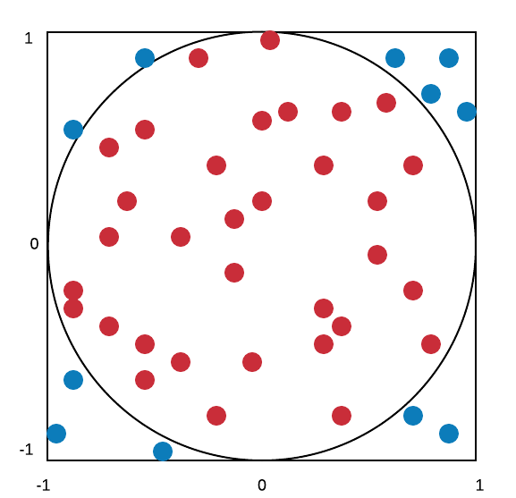

```{r setup,include=F}
knitr::opts_chunk$set(echo=T,
                      # cache=T,autodep=T,
                      fig.align='center',dev='svg')
library(tidyverse)
source("https://bwu62.github.io/stat240-revamp/ggplot_theme_options.R")
options(width=100)
set.seed(1)
```


## Monte Carlo

:::: {.columns}

::: {.column width="67%"}

- Monte Carlo (MC) is a class of **simulation-based** methods for computation, with wide applications in math/science

- Stanisław Ulam (who worked at both UW-Madison & the Manhattan Project) first applied MC to computing the probability a random game of solitaire is solvable

- Origin of name: supposedly named after his uncle's favorite casino

- *Very* flexible approximate method, can do many things, e.g:
  - find probabilities
  - compute expectations
  - estimate parameters
  - test hypotheses,
  - etc...

:::

:::{.column width="33%"}

{.absolute style="z-index:-1;" right=0 top=100 height="500"}

:::

::::


## MC probability estimates

:::{.fragment .no-fade-in .semi-fade-out data-fragment-index=1}
Let $E$ be some event for an RV $X$. Suppose we want to estimate $\p E$

Define the **indicator function** $\i E$ where
$$
\i E(x)=\begin{cases}1&\text{if $x\in E$}\\0&\text{if $x\notin E$}\end{cases}
$$
Let $X_1,...,X_n$ be iid from same distribution as $X$, and let $Y_i=\i E(X_i)$, what RV is $Y_i$?
:::


:::{.fragment .fade-in-then-semi-out data-fragment-index=1 style="margin-top:1em"}
Ans: $Y_i\sim\bern{p=\p E}$, so that $\e{Y_i}=p=\p E$,

Also by LLN, as sample size grows, we'll have $\bar Y\to\e{Y_i}=\p E$
:::

:::{.fragment style="margin-top:1em"}
In other words, to approximately find probability of event $E$, we just need to:

1. Run experiment $X$ a large number of repetitions,
2. Count how many times $E$ occurs,
3. Divide by number of repetitions.
:::


## Example 1: normal draws

As an easy first example, let $X\sim\norm{0,1^2}$, and let $E=(-2,2)$, use MC to evaluate $\p E$

```{r}
# set MC repetitions size
M = 1e6

# draw n samples
X = rnorm(M, mean=0, sd=1)

# count how many in E
E = sum(-2<X & X<2)

# divide by n to get P(E)
E/M

# compare with theoretical value
pnorm(2, mean=0, sd=1) - pnorm(-2, mean=0, sd=1)
```


## Example 2: birthday problem

Suppose birthdays are evenly distributed throughout year (and ignore leap years). In a group of 23 people with independent birthdays, what's the probability **at least 2 people have the same birthday**?

```{r }
# sample 23 days from 1-365 with replacement
(bdays = sample(365, size=23, replace=TRUE))

# check if more than 1 person has same birthday
max(table(bdays)) > 1

# loop above using for()
M = 1e5 ; count = 0
for(i in 1:M){
  if(max(table(sample(365,23,TRUE)))>1){
    count = count+1
  }
}
count / M

# alternative way using replicate()
mean(replicate(M, max(table(sample(365,23,TRUE)))>1 ))
```


## Example 2: birthday problem (cont.)

This problem is exactly solvable. For $n$ people, $1\le n\le365$, probability all $n$ people have distinct birthdays is:
$$
1\cdot\frac{364}{365}\cdot\frac{363}{365}\cdots\frac{365-n+1}{365}=\frac{365!}{(365-n)!\,365^n}
$$
Subtracting this from 1 gives the probability at least 2 people share a birthday. We can define and plot this function in R:

:::: {.columns}

::: {.column width="50%" style="padding-top:1.2em"}

```{r bday,eval=F,echo=T}
# vectorized bday function
bday = Vectorize(
  \(n) 1-prod(365:(365-n+1)/365)
)
tibble(n=1:50, prob=bday(n)) %>%
  ggplot(aes(n,prob)) + geom_line() +
  scale_y_continuous(breaks=0:5/5) +
ggtitle("Chance of shared birthday in n people")
```

<small style="margin-top:2em">*Assigned reading:* [9.3.6 -- Buffon's needle](https://brianreedpowers.github.io/stat340/mc.html#example-buffons-needle) for more practice & [9.4 -- More uses](https://brianreedpowers.github.io/stat340/mc.html#more-uses-for-monte-carlo-integration-by-darts) for application to finding expectations in general & integration</small>

:::

:::{.column width="50%"}

```{r,ref.label='bday',eval=T,echo=F,fig.width=5.5,fig.height=3.5}
```

:::

::::


## MC parameter estimates

:::::{.fragment .no-fade-in .semi-fade-out data-fragment-index=1}

:::: {.columns}

::: {.column width="75%"}

If the simulation result is related to some unknown parameter, this can be used to derive an **estimator** of the parameter.

Example: Consider the length-2 square $S$ with corners at $(\pm1,\pm1)$ and its inscribed circle $C$ with center $(0,0)$ and radius 1.

:::

:::{.column width="25%"}

{.absolute style="z-index:-1;" right=0 top=0 height="270"}

:::

::::

Note a point uniformly sampled over $S$ has $\pi/4$ probability of landing in the circle.
:::

:::{.fragment .fade-in-then-semi-out data-fragment-index=1}
Let $(X_i,Y_i)$ be a point uniformly sampled over $S$, and let $Z_i=\i C(X_i,Y_i)$ where
$$
\i C(x,y)=\begin{cases}
1&\text{if $x^2+y^2\le1$}\\
0&\text{if $x^2+y^2>1$}
\end{cases}
$$
be the indicator function for if the point is in $C$. Note $Z_i\sim\bern{\pi/4}$
:::

:::{.fragment}
Thus, we have the following estimator $\hat\pi=4\bar Z$, and we know for iid sample of size $n$:
$$\e{\hat\pi}=4\e{\bar Z}=\pi\qquad\v{\hat\pi}=4^2\v{\bar Z}=\frac{16}n\left(\frac\pi4\right)\left(1\!-\!\frac\pi4\right)=\frac{\pi(4-\pi)}n$$
:::


## $\hat\pi$ example in R

```{r}
# set sample size
n = 1e6

# simulate X, Y points uniformly over square
X = runif(n, min=-1, max=1)
Y = runif(n, min=-1, max=1)

# how many points also inside circle?
C = sum(X^2 + Y^2 <= 1)

# produce estimate
(est = 4 * C / n)

# percent error
(est-pi)/pi*100
```


## Validating estimator performance

We saw previously $\e{\hat\pi}=\pi$ and $\v{\hat\pi}=\pi(4-\pi)/n$, do these hold?

Pick $n=1000$, i.e. $1000$ points will be used to produce each estimate, and repeat the process to get $M=100$ different MC estimates, then check their mean/var:

```{r}
# use replicate() to get estimates
(est = replicate(100,4*mean(runif(1e3,-1)^2+runif(1e3,-1)^2<1)))

# get mean/var of estimates
c(mean(est), var(est))

# mean clearly agrees with theory, how about var?
pi*(4-pi)/1000
```


## Simulating RVs with arbitrary PDFs

:::{.fragment .no-fade-in .semi-fade-out data-fragment-index=1}
So far, we've only learned how to use built-in `r...()` functions or `sample()` to simulate variables, but can we simulate from arbitrary PDF? Yes, using the following fact:

For any continuous RV $X$ with CDF $F_X$, we have
$$
F_X(X)\sim\unif{0,1}
$$
Note it's $F_X(X)$ not $F_X(x)$, i.e. the CDF is applied to an observation drawn from $X$.
:::

:::{.fragment .fade-in data-fragment-index=1}
Put another way: percentiles of continuous RV draws are uniform. Demo:
:::


:::::{.fragment .absolute .fade-in-then-out data-fragment-index=1}

:::: {.columns}

::: {.column style="width:25%;padding-top:1em;"}

```{r,eval=F,echo=T}
# start with norm
x = rnorm(1e4)
hist(x)
hist(pnorm(x))
```

:::

:::{.column width="75%"}

```{r,eval=T,echo=F,fig.width=8.5,fig.height=3.5}
par(cex=.8,las=1,mfrow=c(1,2),mar=c(3,4,3,0),mgp=c(2,.6,0))
x = rnorm(1e4)
hist(x)
hist(pnorm(x))
```

:::

::::

:::::


:::::{.fragment .absolute .fade-in-then-out}

:::: {.columns}

::: {.column style="width:25%;padding-top:1em;"}

```{r,eval=F,echo=T}
# now try exp
x = rexp(1e4)
hist(x)
hist(pexp(x))
```

:::

:::{.column width="75%"}

```{r,eval=T,echo=F,fig.width=8.5,fig.height=3.5}
par(cex=.8,las=1,mfrow=c(1,2),mar=c(3,4,3,0),mgp=c(2,.6,0))
x = rexp(1e4)
hist(x)
hist(pexp(x))
```

:::

::::

:::::


:::::{.fragment .absolute .fade-in-then-out}

:::: {.columns}

::: {.column style="width:25%;padding-top:1em;"}

```{r,eval=F,echo=T}
# some other dists
x = rchisq(1e4,7)
hist(x)
hist(pchisq(x,7))
```

:::

:::{.column width="75%"}

```{r,eval=T,echo=F,fig.width=8.5,fig.height=3.5}
par(cex=.8,las=1,mfrow=c(1,2),mar=c(3,4,3,0),mgp=c(2,.6,0))
x = rchisq(1e4,7)
hist(x)
hist(pchisq(x,7))
```

:::

::::

:::::


:::::{.fragment .absolute .fade-in}

:::: {.columns}

::: {.column style="width:25%;padding-top:1em;"}

```{r,eval=F,echo=T}
# some other dists
x = rbeta(1e4,.5,.5)
hist(x)
hist(pbeta(x,.5,.5))
```

:::

:::{.column width="75%"}

```{r,eval=T,echo=F,fig.width=8.5,fig.height=3.5}
par(cex=.8,las=1,mfrow=c(1,2),mar=c(3,4,3,0),mgp=c(2,.6,0))
x = rbeta(1e4,.5,.5)
hist(x)
hist(pbeta(x,.5,.5))
```

:::

::::

:::::


## $F_X(X)$ uniformity

:::{.fragment .no-fade-in .semi-fade-out data-fragment-index=1}
Quick proof of this fact. Let $Y=F_X(X)$, i.e. $Y$ is the percentile of a draw from $X$.  
Consider the CDF of $Y$, $F_Y(y)$. By definition:

$$
F_Y(y)=\p{Y\le y}=\p{F_X(X)\le y}
$$
:::

:::{.fragment .fade-in-then-semi-out data-fragment-index=1 style="margin-top:1em"}
By monotonicity of CDFs, $F_X(X)\le y$ implies $F_X^{-1}(F_X(X))\le F_X^{-1}(y)$, so

$$
\p{F_X(X)\le y}=\p{X\le F_X^{-1}(y)}=F_X(F_X^{-1}(y))=y
$$
:::

:::{.fragment style="margin-top:1em"}
This shows $F_Y(y)=y$ which is uniquely the CDF of $\unif{0,1}$.

Brian's notes section [9.7](https://brianreedpowers.github.io/stat340/mc.html#generating-random-variables-and-the-importance-of-randomness) has a nice visual showing this for each draw
:::


## Generating from arbitrary PDFs

:::{.fragment .no-fade-in .semi-fade-out data-fragment-index=1}
Since $F_X(X)\sim\unif{0,1}$ for any continuous $X$, it follows that
$$
X\sim F^{-1}_X(\unif{0,1})
$$
I.e. to simulate an $X$ with arbitrary PDF, we can run its quantile function on $\unif{0.1}$
:::


::::: {.columns}

::::{.column width="50%"}

:::{.fragment data-fragment-index=1}

Exercise: simulate 1000 draws from PDF:

$$
f(x)=\begin{cases}2x&0\le x\le1\\0&\text{otherwise}\end{cases}
$$

with CDF $F(x)=\int_0^xf(x)dx=x^2$

```{r,eval=F,echo=T}
# plot pdf
density = \(x) ifelse(0<x & x<1, 2*x, 0)
plot(density, from=-.5, to=1.5)
```

:::

:::{.fragment data-fragment-index=2}

Ans: apply inverse, i.e. `sqrt()`, to `runif()`

```{r,eval=F,echo=T}
x = sqrt(runif(1000))
hist(x)
```

:::

::::

::::{.column width="50%"}

:::{.fragment data-fragment-index=1}

```{r,eval=T,echo=F,fig.width=5.5,fig.height=2.2}
par(cex=.8,las=1,mar=c(2,4,.2,.2),mgp=c(2,.6,0))
density = \(x) ifelse(0<x & x<1, 2*x, 0)
plot(density,from=-.5,to=1.5,n=1e4)
```

:::

:::{.fragment data-fragment-index=2}

```{r,eval=T,echo=F,fig.width=5.5,fig.height=2.2}
par(cex=.8,las=1,mar=c(2,4,.2,.2),mgp=c(2,.6,0))
hist(sqrt(runif(1000)),main=NULL)
```

:::

::::

:::::


## Note on randomness

- For MC, it's important to have a good source of randomness, which is surprisingly hard

- In R, random number generation is not truly random but **pseudorandom**

- Starting with a seed value, a scrambling algorithm called Mersenne Twister is used to imitate randomness (if no seed set, system time + process ID used)

```{r}
# set seed and generate
set.seed(1)
rnorm(8)
# reset seed and regenerate same values
set.seed(1)
rnorm(8)
```

- Useful for reproducibility in MC problems

- For true randomness, usually need to measure something, e.g. [atmospheric noise](https://www.random.org/randomness/), [radioactive decay](https://fourmilab.ch/hotbits/), or even [lava lamps](https://en.wikipedia.org/wiki/Lavarand) ([used by Cloudflare](https://www.cloudflare.com/learning/ssl/lava-lamp-encryption/))

