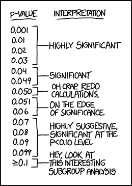

```{r setup,include=F}
knitr::opts_chunk$set(echo=T,
                      # cache=T,autodep=T,
                      fig.align='center',dev='svg')
library(tidyverse)
source("https://bwu62.github.io/stat240-revamp/ggplot_theme_options.R")
options(width=100)
set.seed(1)
control = c(-0.1,-0.55,1.24,-0.97,-0.76,0.21,-0.27,-1.02,0.58,1.67,
              -1.07,0.17,1.45,0.34,1.15,0.18,-0.97,0.43,-1.39,-2.76)
  treatment = c(0.54,0.36,0.59,-0.57,0.53,-0.78,-0.44,-0.98,1.31,0.5,
                0.57,0.49,-0.96,2.41,0.85,1.93,0.95,1.45,1.61,-1.16)
```


## Tea-test (hypothesis testing review)

:::{.fragment .no-fade-in .semi-fade-out data-fragment-index=1}
- Supposedly, [R. A. Fisher](https://en.wikipedia.org/wiki/Ronald_Fisher) invented hypothesis testing in 1935 when trying to test if British phycologist [Muriel Bristol](https://en.wikipedia.org/wiki/Muriel_Bristol) could tell [if her tea was prepared "correctly"](https://en.wikipedia.org/wiki/Lady_tasting_tea), i.e. if milk is added after brewing vs before ([original paper](https://verso.mat.uam.es/~amparo.baillo/MatEstI/Mathematics%20of%20a%20lady%20tasting%20tea.pdf)).

- Below is a slightly modified (for ease of demo) version of the original experiment:
:::

:::{.fragment .fade-in-then-semi-out data-fragment-index=1 style="margin-top:.5em"}
- 8 cups are independently prepared, each with 50% chance of being done "correctly"

- After tasting, Muriel correctly guesses all 8 cups as tea-first or milk-first.  
  
  Exercises:

  1. Do you think she has sufficiently demonstrated she can distinguish between tea-first and milk-first? Give a p-value and write a brief intepretation.
  
  2. Suppose the experiment is repeated with $n$ cups, and again Muriel guesses all $n$ correct. What's the smallest value of $n$ which would result in a significant test at the $\alpha=0.05$ significance level? How about at $0.10$ or $0.01$?
:::


## Tea-test answers

:::{.fragment .no-fade-in .semi-fade-out data-fragment-index=1}
Let $p=$ probability Muriel correctly identifies a given cup. Hypotheses:

> Null: Muriel is guessing completely at random ($p=0.5$)  
> Alt: Muriel has some ability to distinguish them ($p>0.5$)

Note this is a binomial single proportions test from 240. Let $X$ be number of cups correctly identified. Under null, $X\sim\binom{8,0.5}$. Then, p-value can be found as $\p{X\geq8}$, which is just $\p{X=8}$ since she guessed all 8 out of 8 correct.

```{r}
dbinom(8, size=8, prob=0.5)
```
:::

:::{.fragment .fade-in-then-semi-out data-fragment-index=1 style="margin-top:.5em"}
The result is quite significant, so we conclude Muriel can distinguish them. Now, what's the smallest $n$ necessary for each significance level if Muriel guesses all $n$ correct?

```{r}
# remember R distribution functions are all vectorized in all arguments!
dbinom(1:8, size=1:8, prob=0.5)   # alternatively: 0.5^(1:8)
```

So only 4 cups are necessary for 0.10 significance level, 5 cups for 0.05, and 7 cups for 0.01.
:::


## Original experiment

Here's the actual original experiment:

- 8 cups were prepared, 4 of them tea-first and the other 4 milk-first (this is known to the subject). Muriel was asked to identify the 4 cups that were tea-first (suppose you must pick exactly 4). Again, she correctly identified all cups. (Note this is no longer binomial!)

- This time, using an MC approach, compute a p-value for the same hypotheses.  
  (hint: 1. use `sample()` to randomize cup guesses, 2. find distribution of number of correct guesses under null, 3. find p-value.) &nbsp;&nbsp; Answers (in stages):

:::{.fragment}
```{r}
# 1. prepare cups and randomize guesses
cups = c('T','T','T','T','M','M','M','M')  ;  (guess = sample(cups))
```
:::

:::{.fragment}
```{r}
# 2. compare guesses with cups, get total correct, repeat N=1e5 times
reps = replicate(1e5, sum(cups==sample(cups)))  ;  head(reps,n=40)
```
:::

:::{.fragment}
```{r}
# 3. find p-value ≈ 0.014, so again very significant
table(reps)/1e5
```
:::


## Generalized testing steps

Whether using a **parametric** method (e.g. binomial test, t-test) or an MC method, the general steps for a hypothesis test are the same:

:::{.fragment .no-fade-in .semi-fade-out data-fragment-index=1 style="margin-top:-.4em"}
1. Identify hypotheses

   i. **Null** should be something which **predicts a specific distribution of your test statistic**, usually parameter $=$ value, or results due to random chance, etc.
   
   ii. **Alternative** should be opposite of null, and what you "actually want to show", e.g. Muriel can distinguish the preparation method, drug actually effective, etc.
:::

:::{.fragment .fade-in-then-semi-out data-fragment-index=1 style="margin-top:-.6em"}
2. **Assume null to be true** (and actually apply it somewhere!)
:::

:::{.fragment .fade-in-then-semi-out style="margin-top:-.6em"}
3. Pick a useful **test statistic**.

   - Any quantity that tends to look different under the null vs alt can be used!
   
   - The more "different" it tends to look, the more **statistical power** it will have.
:::

:::{.fragment .fade-in-then-semi-out style="margin-top:-.6em"}
4. Find **distribution of statistic assuming null** is true.

   - Can use parametric approach here, OR directly simulate with MC.
:::

:::{.fragment .fade-in-then-semi-out style="margin-top:-.6em"}
5. Find p-value, i.e. **appropriate tail** of distribution corresponding to your real sample data.
:::

:::{.fragment style="margin-top:-.6em"}
6. Interpret results in context of original question.
:::


## Permutation test example

:::{.fragment .no-fade-in .semi-fade-out data-fragment-index=1}
A common technique useful in MC hypothesis test is the **permutation test**. Example:

- Suppose a drug was tested in a randomized controlled trial, and we have this data:

  ```{r}
  control = c(-0.1,-0.55,1.24,-0.97,-0.76,0.21,-0.27,-1.02,0.58,1.67,
              -1.07,0.17,1.45,0.34,1.15,0.18,-0.97,0.43,-1.39,-2.76)
  treatment = c(0.54,0.36,0.59,-0.57,0.53,-0.78,-0.44,-0.98,1.31,0.5,
                0.57,0.49,-0.96,2.41,0.85,1.93,0.95,1.45,1.61,-1.16)
  ```

- Suppose "bigger number better" applies here. Was the treatment statistically effective?
:::

:::{.fragment data-fragment-index=1 style="margin-top:.5em"}
- Let null be "no difference in groups" and alternative be "true mean higher in treatment"

- Under null, two groups NOT different, so data can be **permuted** between groups. Ex:  

  1. Permute data randomly between groups,
  
  2. Find distribution of difference in means under null,
  
  3. Use this to find p-value of sample difference.
:::


## Permutation test example (cont.)

1. Permute data randomly between groups
2. Find distribution of difference in means under null,
3. Use this to find p-value of sample difference.

Answers (in stages):

:::{.fragment}
```{r}
# 1. permute data and compute a single run of mean difference
(permuted = sample(c(control,treatment)))
mean(permuted[1:20]) - mean(permuted[21:40])
```
:::

:::{.fragment style="margin-top:.5em"}
```{r}
# 2. replicate, returning difference of groups under null
reps = replicate(1e5, {perm=sample(c(control,treatment));mean(perm[1:20])-mean(perm[21:40])})
```
:::

:::{.fragment style="margin-top:.5em"}
```{r}
# 3. find p-value as appropriate tail
mean(reps >= mean(treatment)-mean(control))
```
:::


## Test results

::::{.fragment .no-fade-in .semi-fade-out data-fragment-index=1}
In the real world, for any given problem, the **null hypothesis is either true or false**. Depending on the result of your test, 4 overall outcomes are possible:

:::{style="margin:.8em 0"}
||H~0~ rejected (positive/significant)|H~0~ not rejected (negative/insignificant)|
|--:|:--------:|:----------:|
|H~0~ true|False positive (type I error)|True negative|
|H~0~ false|True positive|False negative (type II error)|
:::

**Note:** you do NOT get to choose if H~0~ is true or false, one of these is simply true for your reality; you only get to decide the outcome of your test (positive/negative).
::::

:::{.fragment .fade-in-then-semi-out data-fragment-index=1}
1. If H~0~ actually true, probability of **type I error**, $\p{\text{reject }H_0\mid H_0\text{ true}}=\alpha$
   - This is the same $\alpha$ as when we set the **significance level** of a test

2. If H~0~ actually false,
   - Probability of **type II error**, $\p{\text{do not reject }H_0\mid H_0\text{ false}}=\beta$
   - Probability of **true positive**, $\p{\text{reject }H_0\mid H_0\text{ false}}=1-\beta$, also called **power** or **sensitivity** of a test
:::


## Testing exercise

Suppose you are a quality assurance agent at a factory checking for defects. For each product, define $H_0$ as "there is no defect". You pass or fail products depending on if you think there's a defect or not. Label each of the following outcomes with the following labels: true positive, true negative, type I error, type II error.

a. You passed a defective product: &nbsp; [**type II error**]{.fragment data-fragment-index=1}

b. You passed a good product: &nbsp; [**true negative**]{.fragment data-fragment-index=1}

c. You failed a good product: &nbsp; [**type I error**]{.fragment data-fragment-index=1}

d. You failed a defective product: &nbsp; [**true positive**]{.fragment data-fragment-index=1}


## Testing exercise #2

The skin prick test (SPT) is a method for determining dog and cat allergies. A new SPT is developed and 200 random people from the population are tested. A patient is assumed to not have an allergy unless the test shows that they do. Their actual allergy status and the results of the test are below:

:::{style="margin:-.5em 0 .5em"}
||Allergy|No Allergy|
|-:|:-:|:-:|
|Positive SPT result|16|26|
|Negative SPT result|8|150|
:::

a. Estimate the type I error rate of SPT. &nbsp; [**26/176**]{.fragment data-fragment-index=1}
b. Estimate the type II error rate of SPT. &nbsp; [**8/24**]{.fragment data-fragment-index=1}
c. Estimate the power of SPT. &nbsp; [**16/24**]{.fragment data-fragment-index=1}
d. If the prevalence (allergy rate) in the population increases, will the power of the test increase,
decrease, stay the same, or is there not enough information to tell? Explain!  
[**no change; power doesn't depend on prevalence**]{.fragment data-fragment-index=1}


## Rejection region

::::{.fragment .no-fade-in .semi-fade-out data-fragment-index=1}
For a certain test, statistics that would give a positive result form the **rejection region**.

Example: Suppose a coin has true probability $p$ of being heads (unknown to us). We wish to determine at $\alpha=0.05$ if the coin is fair, so we flip it 200 times and count the number of heads $X$. (Exercise for home: plot the distribution of $X$ assuming the coin is fair)

Let null: coin is fair ($p=0.5$); for alternative consider each case, A: two-sided ($p\ne0.5$), B: one-sided lesser ($p<0.5$), C: one-sided greater ($p>0.5$). Rejection region of each:
:::

::::{.columns .fragment data-fragment-index=1}

:::{.column style="width:62%;padding-right:20px!important;"}

```{r}
# rejection region for A, # i.e. if X≤85 or X≥115 reject Ho
c(qbinom(0.025,200,0.5)-1, qbinom(0.975,200,0.5)+1)
# check both sides
c(2*pbinom(85,200,0.5), 2*pbinom(86,200,0.5))
c(2*(1-pbinom(115-1,200,0.5)), 2*(1-pbinom(114-1,200,0.5)))
```

:::

:::{.column style="width:35%;"}

```{r}
# rejection region for B,
# i.e. if X≤87 we reject Ho
c(qbinom(0.05,200,0.5)-1)
# rejection region for C,
# i.e. if X≥113 we reject Ho
qbinom(0.95,200,0.5)+1
```

:::

::::


## Rejection region (cont.)

::::{.fragment .no-fade-in .semi-fade-out data-fragment-index=1}
Summary: for $X\sim\binom{200,p}$, to test $H_0:p=0.5$, rejection region for each $H_a$:

- Case A: $H_a:p\ne0.5$: region: $X\le85$ or $X\ge115$
- Case B: $H_a:p<0.5$: region: $X\le87$
- Case C: $H_a:p>0.5$: region: $X\ge113$
:::

:::{.fragment .fade-in-then-semi-out data-fragment-index=1}
We can use this to find the **rejection rate** as a **function of $p$**, i.e. for coins with different levels of "fairness"/"unfairness" $p$, what's the **probability of a positive test**?

```{r eval=F}
# define rejection rate functions for each case
fA = \(p) pbinom(85,200,p)+(1-pbinom(115-1,200,p))
fB = \(p) pbinom(87,200,p)
fC = \(p) 1-pbinom(113-1,200,p)
ggplot() + labs(x="p", y="rate") +
  geom_function(aes(color="A ≠"), fun=fA, xlim=c(.25,.75), n=1e4) +
  geom_function(aes(color="B <"), fun=fB, xlim=c(.25,.75), n=1e4) +
  geom_function(aes(color="C >"), fun=fC, xlim=c(.25,.75), n=1e4)
```
:::


## Rejection rate vs $p$ for $\alpha=0.05$

```{r,echo=F,fig.width=9,fig.height=5}
fA = \(p) pbinom(85,200,p)+(1-pbinom(115-1,200,p))
fB = \(p) pbinom(87,200,p)
fC = \(p) 1-pbinom(113-1,200,p)
ggplot() + labs(x="p", y="rate") +
  geom_function(aes(color="A ≠"), fun=fA, xlim=c(.25,.75), n=1e4, linewidth=1.5) +
  geom_function(aes(color="B <"), fun=fB, xlim=c(.25,.75), n=1e4, linewidth=1.5) +
  geom_function(aes(color="C >"), fun=fC, xlim=c(.25,.75), n=1e4, linewidth=1.5) +
  scale_color_brewer(palette = "Set1") + 
  scale_x_continuous(expand=0) + 
  scale_y_continuous(breaks=c(0.05,0:10/10),labels=c("α = 0.05","0.00",paste0(1:9/10,"0"),"1.00"),expand=c(0,.01),minor_breaks=NULL)
```


## Rejection rate (cont.)

Key observations:

- When null is true, i.e. $p=0.5$, rejection rate of $\alpha=0.05$ approximately achieved
  
  - i.e. type I error rate is **correctly controlled**

- If not sure which side $p$ is on, or both directions needed, two-sided test is better

  - i.e. non-zero **power** on both sides

- If side of $p$ known, one-sided test is better

  - i.e. strictly **higher power** on corresponding side vs two-sided test

- Note: if wrong side is chosen, power quickly falls to 0!

How about for $\alpha=0.10$ or $0.01$?


## Rejection rate vs $p$ for $\alpha=0.10$

```{r,echo=F,fig.width=9,fig.height=5}
fA = \(p) pbinom(87,200,p)+(1-pbinom(113-1,200,p))
fB = \(p) pbinom(90,200,p)
fC = \(p) 1-pbinom(110-1,200,p)
ggplot() + labs(x="p", y="rate") +
  geom_function(aes(color="A ≠"), fun=fA, xlim=c(.25,.75), n=1e4, linewidth=1.5) +
  geom_function(aes(color="B <"), fun=fB, xlim=c(.25,.75), n=1e4, linewidth=1.5) +
  geom_function(aes(color="C >"), fun=fC, xlim=c(.25,.75), n=1e4, linewidth=1.5) +
  scale_color_brewer(palette = "Set1") + 
  scale_x_continuous(expand=0) + 
  scale_y_continuous(breaks=c(0,0.1,2:10/10),labels=c("0.0", "α = 0.1",2:9/10,"1.0"),expand=c(0,.01),minor_breaks=NULL)
```


## Rejection rate vs $p$ for $\alpha=0.01$

```{r,echo=F,fig.width=9,fig.height=5}
fA = \(p) pbinom(81,200,p)+(1-pbinom(119-1,200,p))
fB = \(p) pbinom(83,200,p)
fC = \(p) 1-pbinom(117-1,200,p)
ggplot() + labs(x="p", y="rate") +
  geom_function(aes(color="A ≠"), fun=fA, xlim=c(.25,.75), n=1e4, linewidth=1.5) +
  geom_function(aes(color="B <"), fun=fB, xlim=c(.25,.75), n=1e4, linewidth=1.5) +
  geom_function(aes(color="C >"), fun=fC, xlim=c(.25,.75), n=1e4, linewidth=1.5) +
  scale_color_brewer(palette = "Set1") + 
  scale_x_continuous(expand=0) + 
  scale_y_continuous(breaks=c(.01,1:10/10),labels=c("α = .01",1:9/10,"1.0"),expand=c(0,.01),minor_breaks=NULL)
```


## How to choose statistics?

- Different statistics may be more or less appropriate for different problems, and even different hypotheses setup. For coin flips, some possibilities:

  - Number/proportion of total heads
  
  - Mean or max consecutive sequences of heads
  
  - Distribution of sequential pairs of heads
  
  - etc...

Remember: any quantity that tends to differ between $H_0$ and $H_a$ can be used!


## Choosing significance level $\alpha$

::::{.fragment .no-fade-in .semi-fade-out data-fragment-index=1}
 - By default (from Fisher) $\alpha\!=\!0.05$ just "felt right", but can choose any value
 
 - Other choices may be more common in different fields, e.g.
 
   - In particle physics, "[five-sigma](https://arxiv.org/pdf/1310.1284)" (i.e. one-tail p-value 5 SDs away on normal) is standard for discoveries, to ensure high confidence in new claims
     
     ```{r}
     # 5-sigma correspond to alpha ≈ 3e-7
     pnorm(-5)
     ```
   
   - In social sciences, often difficult/costly to run experiments, so $\alpha\!=\!0.10$ is common
:::

:::{.fragment .fade-in-then-semi-out data-fragment-index=1}
- Crucially, $\alpha$ should be set **before** experiment is run and NOT changed after analysis!

- These interpretation phrases, though somewhat vague, are commonly used:

  - $p>0.10~$ generally "not significant"
  
  - $p<0.10~$ often called "weakly significant"
  
  - $p<0.05~$ often called "significant"
  
  - $p<0.01~$ often called "strongly significant"
:::


## P-value interpretations

<center>{height="550"}</center>

<small>source: <https://xkcd.com/1478/></small>


## Impact of different $\alpha$ values

Looking at table again:

:::{style="margin:.8em 0"}
||H~0~ rejected (positive/significant)|H~0~ not rejected (negative/insignificant)|
|--:|:--------:|:----------:|
|H~0~ true|False positive (prob $=\alpha$)|True negative (prob $=1\!-\!\alpha)$|
|H~0~ false|True positive (prob $=1\!-\!\beta$)|False negative (prob $=\beta$)|
:::

- **Higher $\alpha$** means **more rejections** &nbsp; (lower $\alpha$ means fewer rejections)

- Generally, **raising $\alpha$ lowers $\beta$** &nbsp; (lowering $\alpha$ raises $\beta$)

- Also, **raising $\alpha$ raises power** &nbsp; (lowering $\alpha$ lowers power)

- Generally, only way to lower both $\alpha$, $\beta$ is to increase sample size

Tradeoffs all around!
