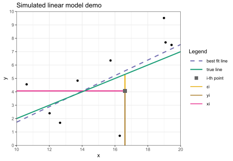
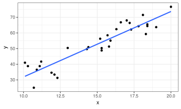
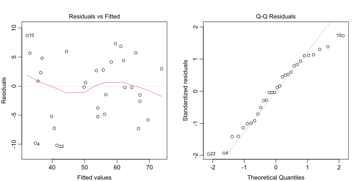
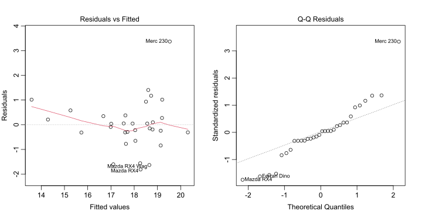

## Simple linear regression (SLR) review

:::{.fragment .no-fade-in .semi-fade-out data-fragment-index=1}
Quick overview of SLR (one predictor, one response) from 240:

- Let $X$, $Y$ be numeric RVs with **clear linear relationship**; recall theoretical correlation:
  $$\rho_{X,Y}=\frac{\cov{X,Y}}{\sqrt{\v X\v Y}}$$
  In sample, we observe **sample correlation coefficient**:
  $$r=\frac{\frac1{n-1}\sum(x_i-\bar x)(y_i-\bar y)}{s_xs_y}$$
:::

:::{.fragment data-fragment-index=1 style="margin-top:-1em"}
- Note $n\!-\!1$ used in numerator instead of $n$, similar to sample SDs $s_x$, $s_y$

- $\rho$, $r$ always in $[-1,1]$, where:
  - Sign (positive/negative/zero) indicates **direction of slope** of best fit line, and
  - Absolute value indicates **strength of correlation** (closer to ±1 means stronger)

- **Note:** correlation coefficient ***assumes*** linear relationship; ***must*** be checked with plot!

- Interactive correlation demo: <https://bwu62.shinyapps.io/correlation>
:::


## SLR model

:::{.fragment .no-fade-in .semi-fade-out data-fragment-index=1}
Let $(x_i,y_i)$ be sample of size $n$ of apparently linear points. **Model equation** for SLR:
$$
y_i=\beta_0+\beta_1x_i+\ep_i
$$

- $\beta_0$, $\beta_1$ are true intercept & slope (treated as constants like $x_i$)

- $\ep_i\iid\norm{0,\sigma^2}$ are **errors** of each point (the only variable on RHS!)
:::

:::: {.columns .fragment data-fragment-index=1}

::: {.column width="40%"}
MC simulated demo:


::: {.cell layout-align="center"}

```{.r .cell-code}
b0  = -3             # true intercept
b1  = 0.5            # true slope
n   = 10             # sample size
m   = 10             # min X range
M   = 20             # max X range
sig = 2              # true sigma
x   = runif(n,m,M)   # generate Xs
e   = rnorm(n,0,sig) # generate errors
y   = b0 + b1*x + e  # combine for Ys
```
:::


:::

:::{.column width="60%"}


::: {.cell layout-align="center"}
::: {.cell-output-display}
{fig-align='center' width=624}
:::
:::


:::

::::


## OLS fitting

:::: {.columns .fragment .no-fade-in .semi-fade-out data-fragment-index=1}

::: {.column width="50%"}
Typically **ordinary least squares** (OLS) used to fit, i.e. **sum of squared errors** minimized. Given some $\beta_0',\beta_1'$, define OLS **loss function**:

$$
\ell(\beta_0',\beta_1')=\sum_{i=1}^n(y_i-(\beta_0'+\beta_1'x_i))^2
$$

To minimize $\ell(\beta_0',\beta_1')$, set partial derivatives vs $\beta_0'$, $\beta_1'$ to 0 and solve ([full derivation](https://statproofbook.github.io/P/slr-ols.html))
:::

:::{.column width="50%"}
{.absolute style="z-index:-1;" right=0 top=0 height="420"}
:::

::::

:::{.fragment data-fragment-index=1}
Best fit coefficients:
$$
\hat\beta_1~=~r\cdot\frac{s_y}{s_x}~~\,\\
\hat\beta_0~=~\bar y-\hat\beta_1\bar x
$$

- **Note:** equivalent to line with slope $\hat\beta_1$ passing through $(\bar x,\bar y)$

- Can be shown these estimators are [unbiased with least variance](https://en.wikipedia.org/wiki/Gauss%E2%80%93Markov_theorem)
:::


## Inference

:::{.fragment .no-fade-in .semi-fade-out data-fragment-index=1}
After fitting, our **fitted** or **predicted values** $\hat y_i$ are found by pluggin $x_i$ back:

$$
\hat y_i=\hat\beta_0+\hat\beta_1x_i
$$

Then our **residuals** $\hat\ep_i$ are the realizations of $\ep_i\sim\norm{0,\sigma^2}$, defined:

$$
\hat\ep_i=y_i-\hat y_i=y_i-(\hat\beta_0+\hat\beta_1x_i)
$$
:::

:::{.fragment data-fragment-index=1 style="margin-top:1em"}
Using these, we estimate $\sigma^2$ using the **mean squared error** of the residuals:

$$
\hat\sigma^2=\frac{\ell(\hat\beta_0,\hat\beta_1)}{n-2}=\frac{\sum\hat\ep_i^2}{n-2}=\frac1{n-2}\sum_i(y_i-(\hat\beta_0+\hat\beta_1x_i))^2
$$

Can be shown $\hat\sigma^2$ is unbiased estimator for $\sigma^2$. Note: $\sigma^2$ is important since this represents the **amount of noise** in the data. Higher $\sigma^2$ $\to$ more noise $\to$ less precise results.

Remember to check if $\hat\ep_i\sim\norm{0,\sigma^2}$ with residual plots!
:::


## SE of coefficients

:::{.fragment .no-fade-in .semi-fade-out data-fragment-index=1}
Slope SE can be easily derived now. First, note:
$$
\begin{align}
\sum(x_i-\bar x)(y_i-\bar y)&=\sum(x_i-\bar x)y_i-\bar y\cancel{\sum(x_i-\bar x)}\\
&=\sum(x_i-\bar x )(\beta_0+\beta_1x_i+\ep_i)
\end{align}
$$
:::

:::{.fragment .fade-in-then-semi-out data-fragment-index=1}
$$
\begin{align}
\v{\hat\beta_1}
&=\V{\frac{\sum(x_i-\bar x)(y_i-\bar y)}{\sum(x_i-\bar x)^2}}=\V{\frac{\sum_i(x_i-\bar x)(\cancel{\beta_0 +\beta_1x_i}+\ep_i )}{\sum (x_i-\bar x)^2}}\\
&=\frac{\sum (x_i-\bar x)^2\text{Var}(\ep_i)}{\left(\sum (x_i -
\bar x)^2\right)^2}=\frac{\sigma^2}{\sum_i (x_i-\bar x)^2}
\end{align}
$$
:::

:::{.fragment}
Then, using our sample we can estimate $\displaystyle\se(\hat\beta_1)=\sqrt{\frac{\hat\sigma^2}{s_x^2(n-1)}}$. Similar process gives:

$\displaystyle\v{\hat\beta_0}=\sigma^2\!\left[\frac1n+\frac{\bar x^2}{\sum_i (x_i-\bar x)^2}\right]$, so estimate $\displaystyle\se(\hat\beta_0)=\sqrt{\hat\sigma^2\!\left[\frac1n+\frac{\bar x^2}{s_x^2(n-1)}\right]}$
:::


## Inference on coefficients

:::{.fragment .no-fade-in .semi-fade-out data-fragment-index=1}
Coefficients $\hat\beta_0$, $\hat\beta_1$ follow T-distributions with $n\!-\!2$ degrees of freedom.

- For hypothesis testing, e.g. $H_0\!:\!\beta_1=0~$ vs $~H_a\!:\!\beta_1\ne0$, use: $$t_\obs~=~\frac{\hat\beta_1-0}{\se(\hat\beta_1)}\sim T_{n-2}$$
:::

:::{.fragment data-fragment-index=1}
- For confidence intervals, e.g. C% interval for $\beta_1$, use:
$$
\text{$C\%$ or $(1\!-\!\alpha)$ interval}~=~\hat\beta_1\pm t_{\alpha/2,\,n-2}\cdot\se(\hat\beta_1)
$$

  - $t_{\alpha/2,\,n-2}$ is T critical value, e.g. `qt(0.975,df=n-2)` for 95%

  - Can also use `confint()` function
:::


## Confidence/prediction interval for predictions

<style>#confidenceprediction-interval-for-predictions span.display mjx-container{font-size:85%!important}</style>

:::: {.columns}

Suppose we take new observation at $X=x_\new$, can make two different intervals at there:

::: {.column width="40%"}

- **Confidence interval** for mean predicted response $\hat y$ (i.e. for the regression line), which has:
$$\se(\hat y)\!=\!\sqrt{\hat\sigma^2\!\left[\frac1n\!+\!\frac{(x_\new\!-\!\bar x)^2}{s_x^2(n-1)}\right]}~~~~~$$

- **Prediction interval** for next individual data point $y_\new$ (i.e. for the data points), which has:
$$\se(y_\new)\!=\!\sqrt{\hat\sigma^2\!\left[1\!+\!\frac1n\!+\!\frac{(x_\new\!-\!\bar x)^2}{s_x^2(n-1)}\right]}~~~$$

:::

:::{.column width="60%"}

{.absolute style="z-index:-1;" right=-10 top=150 height="400"}

:::

::::

- Can also use &nbsp; `predict(lm.object, interval="confidence")` &nbsp; or &nbsp; `"prediction"`


## Cumulative SLR exercise!


::: {.cell layout-align="center"}

:::


Suppose you have the following observations:

>     x = c(14.4, 15.3, 11.2, 10.7, 11.9, 13, 18.4, 15.3, 17.3, 10.1, 18.4, 18.1, 16.6, 15.7, 10.3, 19, 10.9, 16.3, 17, 17.2, 14.3, 12.3, 15.8, 17.8, 15.2, 20, 11.1, 18.3, 15.9, 12.1) 
>     y = c(50.9, 50.3, 41.7, 25, 34.6, 50.4, 65.5, 48.8, 62.2, 41, 64.4, 71.5, 66.8, 58.5, 38.8, 63.7, 36.5, 62.4, 68, 66.4, 49.7, 31.3, 51.3, 64.3, 56.3, 76.7, 38.8, 59.3, 55.1, 33.4)

Do the following (try both manually and using R functions):

1. Plot the data, check if SLR is appropriate, and find the correlation $r$,

2. Fit a best fit line, plot it, and find the coefficients $\hat\beta_1$, $\hat\beta_0$,

3. Find the fitted values $\hat y_i$ and residuals $\hat\ep_i$, and check model assumptions,

4. Estimate SD of errors $\sigma$ and SEs of coefficients $\hat\beta_1$, $\hat\beta_0$,

5. Find p-value for testing $\beta_1\!=\!0$ vs not, and give 95% CIs for $\beta_1$, $\beta_0$,

6. At $X\!=\!18$, give and interpret 95% confidence and prediction intervals.

Answers using R functions shown first:


## Exercise answers using R functions


::: {.cell layout-align="center"}

```{.r .cell-code}
# plot data, best fit line, and find correlation
ggplot(tibble(x,y),aes(x,y)) + geom_point() + geom_smooth(method=lm,se=F)
cor(x,y)
```

::: {.cell-output .cell-output-stdout}

```
[1] 0.9196951
```


:::

::: {.cell-output-display}
{fig-align='center' width=480}
:::
:::


## Exercise answers using R functions (cont.)


::: {.cell layout-align="center"}

```{.r .cell-code}
# fit with lm(), print summary with coefficients, SEs, and residual SE
# also shows coefficient p-values for testing each =0 vs ≠0
model = lm(y ~ x, data = tibble(x,y))
summary(model)
```

::: {.cell-output .cell-output-stdout}

```

Call:
lm(formula = y ~ x, data = tibble(x, y))

Residuals:
     Min       1Q   Median       3Q      Max 
-10.2063  -4.5742   0.2184   4.3378   8.6965 

Coefficients:
            Estimate Std. Error t value Pr(>|t|)    
(Intercept)  -9.9455     5.1557  -1.929   0.0639 .  
x             4.1831     0.3375  12.395 6.92e-13 ***
---
Signif. codes:  0 '***' 0.001 '**' 0.01 '*' 0.05 '.' 0.1 ' ' 1

Residual standard error: 5.381 on 28 degrees of freedom
Multiple R-squared:  0.8458,	Adjusted R-squared:  0.8403 
F-statistic: 153.6 on 1 and 28 DF,  p-value: 6.916e-13
```


:::
:::


## Exercise answers using R functions (cont.)


::: {.cell layout-align="center"}

```{.r .cell-code}
# fitted values
fitted(model) %>% unname %>% round(2)
```

::: {.cell-output .cell-output-stdout}

```
 [1] 50.29 54.06 36.90 34.81 39.83 44.43 67.02 54.06 62.42 32.30 67.02 65.77 59.49 55.73 33.14 69.53
[17] 35.65 58.24 61.17 62.00 49.87 41.51 56.15 64.51 53.64 73.72 36.49 66.60 56.57 40.67
```


:::

```{.r .cell-code}
# residuals
resid(model) %>% unname %>% round(2)
```

::: {.cell-output .cell-output-stdout}

```
 [1]   0.61  -3.76   4.80  -9.81  -5.23   5.97  -1.52  -5.26  -0.22   8.70  -2.62   5.73   7.31
[14]   2.77   5.66  -5.83   0.85   4.16   6.83   4.40  -0.17 -10.21  -4.85  -0.21   2.66   2.98
[27]   2.31  -7.30  -1.47  -7.27
```


:::

```{.r .cell-code}
# check model
par(mfrow=c(1,2))  ;  plot(model,which=1:2)
```

::: {.cell-output-display}
{fig-align='center' width=960}
:::
:::


## Exercise answers using R functions (cont.)


::: {.cell layout-align="center"}

```{.r .cell-code}
# confidence intervals for coefficients
confint(model, level = 0.95)
```

::: {.cell-output .cell-output-stdout}

```
                 2.5 %    97.5 %
(Intercept) -20.506486 0.6153899
x             3.491761 4.8743932
```


:::

```{.r .cell-code}
# confidence/prediction intervals for prediction at new X=18
predict(model, newdata = data.frame(x=18), interval = "confidence")
```

::: {.cell-output .cell-output-stdout}

```
       fit      lwr     upr
1 65.34984 62.45838 68.2413
```


:::

```{.r .cell-code}
predict(model, newdata = data.frame(x=18), interval = "prediction")
```

::: {.cell-output .cell-output-stdout}

```
       fit      lwr     upr
1 65.34984 53.95459 76.7451
```


:::
:::


Answers using manual computation shown on next slides:


## Exercise answers computing manually


::: {.cell layout-align="center"}

```{.r .cell-code}
# define useful values
n = length(x) ; mx = mean(x) ; my = mean(y) ; sx = sd(x) ; sy = sd(y) ; r = cor(x,y)
# best fit slope and intercept
c(b1 <- r*sy/sx, b0 <- my-b1*mx)
```

::: {.cell-output .cell-output-stdout}

```
[1]  4.183077 -9.945548
```


:::

```{.r .cell-code}
# fitted and residual values
fitted = b0 + b1*x  ;  resid = y - fitted
# residual standard error
(sigma.hat = sqrt(sum(resid^2)/(n-2)))
```

::: {.cell-output .cell-output-stdout}

```
[1] 5.380917
```


:::

```{.r .cell-code}
# estimated SE of coefficients
(se.b1 = sigma.hat*sqrt(1/(sx^2*(n-1))))
```

::: {.cell-output .cell-output-stdout}

```
[1] 0.3374895
```


:::

```{.r .cell-code}
(se.b0 = sigma.hat*sqrt(1/n+mx^2/(sx^2*(n-1))))
```

::: {.cell-output .cell-output-stdout}

```
[1] 5.155683
```


:::

```{.r .cell-code}
# test true slope =0 vs ≠0
(b1.stat = b1/se.b1)
```

::: {.cell-output .cell-output-stdout}

```
[1] 12.39469
```


:::

```{.r .cell-code}
(b1.pval = 2*pt(-abs(b1.stat), df=n-2))
```

::: {.cell-output .cell-output-stdout}

```
[1] 6.916425e-13
```


:::
:::


## Exercise answers computing manually (cont.)


::: {.cell layout-align="center"}

```{.r .cell-code}
# confidence intervals for both coefficients
(t.crit = qt(0.975, df=n-2))
```

::: {.cell-output .cell-output-stdout}

```
[1] 2.048407
```


:::

```{.r .cell-code}
(b1 + c(-1,1)*t.crit*se.b1)
```

::: {.cell-output .cell-output-stdout}

```
[1] 3.491761 4.874393
```


:::

```{.r .cell-code}
(b0 + c(-1,1)*t.crit*se.b0)
```

::: {.cell-output .cell-output-stdout}

```
[1] -20.5064861   0.6153899
```


:::

```{.r .cell-code}
# confidence/prediction intervals for prediction at new X=18
(y.new = b0 + b1*18)
```

::: {.cell-output .cell-output-stdout}

```
[1] 65.34984
```


:::

```{.r .cell-code}
(se.conf = sigma.hat*sqrt(1/n+(18-mx)^2/(sx^2*(n-1))))
```

::: {.cell-output .cell-output-stdout}

```
[1] 1.411564
```


:::

```{.r .cell-code}
(se.pred = sigma.hat*sqrt(1+1/n+(18-mx)^2/(sx^2*(n-1))))
```

::: {.cell-output .cell-output-stdout}

```
[1] 5.562983
```


:::

```{.r .cell-code}
(y.new + c(-1,1)*t.crit*se.conf)
```

::: {.cell-output .cell-output-stdout}

```
[1] 62.45838 68.24130
```


:::

```{.r .cell-code}
(y.new + c(-1,1)*t.crit*se.pred)
```

::: {.cell-output .cell-output-stdout}

```
[1] 53.95459 76.74510
```


:::
:::


## Verify SEs with MC

Can verify the coefficient SEs with MC:


::: {.cell layout-align="center"}

```{.r .cell-code}
# use same X vector
x = c(14.4,15.3,11.2,10.7,11.9,13,18.4,15.3,17.3,10.1,18.4,18.1,16.6,15.7,10.3,
      19,10.9,16.3,17,17.2,14.3,12.3,15.8,17.8,15.2,20,11.1,18.3,15.9,12.1)
n = length(x)

# previous y points generated with:
b1 = 4 ; b0 = -8 ; sigma = 6

# generate many new samples, fit, and extract coefficients
betas = replicate(1e4, coef(lm(b0 + b1*x + rnorm(n,0,sigma) ~ x)) )
b0s = betas[1,] ; b1s = betas[2,]
c(mean(b0s), mean(b1s))
```

::: {.cell-output .cell-output-stdout}

```
[1] -7.986806  3.998902
```


:::

```{.r .cell-code}
# empirical SEs
c(sd(b0s), sd(b1s))
```

::: {.cell-output .cell-output-stdout}

```
[1] 5.7415962 0.3755352
```


:::

```{.r .cell-code}
# theoretical values
sigma * sqrt(1/n + mx^2/(sx^2*(n-1)))
```

::: {.cell-output .cell-output-stdout}

```
[1] 5.748852
```


:::

```{.r .cell-code}
sigma * sqrt(1/(sx^2*(n-1))) 
```

::: {.cell-output .cell-output-stdout}

```
[1] 0.3763182
```


:::
:::


## How "good" is fit?

:::{.fragment .no-fade-in .semi-fade-out data-fragment-index=1}
Often how "good" a fit is can have 2 different interpretations:

- Is the model **appropriate** for the data? I.e. is the linear model assumption correct?

  - Answered by checking residual plots: are they normal, 0-mean, constant variance?
:::

:::{.fragment .fade-in-then-semi-out data-fragment-index=1 style="margin-top:-.5em"}
- Alternatively, can ask how **predictive** is model? I.e. is $X$ predicting $Y$ well?

  - Often answered with **coefficient of determination** $R^2$, which $=(r)^2$ [for SLR](https://statproofbook.github.io/P/slr-rsq.html)
  
  - Formal definition: recall data composed of "signal" and "noise" components; after fitting,  
    **Total** variability of reponse, $~\tss=\sum(y_i-\bar y)^2~$ (also SST) [partitioned into](https://statproofbook.github.io/P/slr-pss.html):
    
    i) Portion explained by **Model** $~\mss=\sum(\hat y_i-\bar y)^2~$ (also ESS or SSR)
    ii) **Residuals** portion not explained by model $~\rss=\sum(y_i-\hat y_i)^2~$ (also SSE or SSR)
:::

:::: {.columns .fragment}

::: {.column width="30%"}

$$
~~~~~R^2=\frac{\tss-\rss}\tss=\frac\mss\tss\\[6pt]=1-\frac\rss\tss~~~~~~
$$

:::

:::{.column width="70%"}

{.absolute style="z-index:-1;" right=-10 bottom=0 height="240"}

:::

::::


## R^2^ example

For previous fit,


::: {.cell layout-align="center"}

```{.r .cell-code}
# print portion of summary table
summary(model)  %>% capture.output %>% tail(11) %>% cat(sep="\n")
```

::: {.cell-output .cell-output-stdout}

```
Coefficients:
            Estimate Std. Error t value Pr(>|t|)    
(Intercept)  -9.9455     5.1557  -1.929   0.0639 .  
x             4.1831     0.3375  12.395 6.92e-13 ***
---
Signif. codes:  0 '***' 0.001 '**' 0.01 '*' 0.05 '.' 0.1 ' ' 1

Residual standard error: 5.381 on 28 degrees of freedom
Multiple R-squared:  0.8458,	Adjusted R-squared:  0.8403 
F-statistic: 153.6 on 1 and 28 DF,  p-value: 6.916e-13
```


:::

```{.r .cell-code}
# compute R² from formula
1-sum(resid(model)^2)/(sy^2*(n-1))
```

::: {.cell-output .cell-output-stdout}

```
[1] 0.845839
```


:::

```{.r .cell-code}
# compare with correlation²
r^2
```

::: {.cell-output .cell-output-stdout}

```
[1] 0.845839
```


:::
:::


Interpretation: about 85% of variation in Y explained by variation in X


## Multiple linear regression (MLR)

:::{.fragment .no-fade-in .semi-fade-out data-fragment-index=1}
Generally speaking, MLR same as SLR but with more terms. Model equation:

$$
y_i=\beta_0+\beta_1x_{i,1}+\beta_2x_{i,2}+\cdots+\beta_px_{i,p}+\ep_i
$$

- $\beta_0$, $\beta_1$, ..., $\beta_p$ are true intercept & slopes (still constants like all $x_{i,j}$)

- $\ep_i\iid\norm{0,\sigma^2}$ are **errors** of each point (still the only variable on RHS!)

- Still usually fit with OLS, i.e. make squares of distances from points as small as possible

- Derivation arguably simpler than SLR ([details here](https://pages.stat.wisc.edu/~bwu62/mlr_derivation))
:::

:::{.fragment .fade-in-then-semi-out data-fragment-index=1}
Only some key differences in MLR:

- Degrees of freedom: $n-(p+1)$, one for each coefficient (note $p=1$ gives SLR's $n-2$)

- Coefficients interpreted as expected change in $Y$ **while holding other variables constant**

  - MLR naturally attempts to attribute changes in $Y$ associated with each variable
  
  - Useful to account/control for other influencing variables
  
  - Downside: predictors should not be strongly correlated, i.e. **multicollinearity** (can use statistics like [VIF](https://www.sthda.com/english/articles/39-regression-model-diagnostics/160-multicollinearity-essentials-and-vif-in-r) to detect)
:::


## MLR exercise

<style>#multiple-linear-regression-mlr span.display mjx-container{font-size:100%!important;padding:0!important;}</style>

:::{.fragment .no-fade-in .semi-fade-out data-fragment-index=1}
Fitting in R: simply add more variables to `y ~ var1 + var2 + ...` formula in `lm()` call

Exercise: recall `mtcars` which contains fuel efficiency data for several cars, fit an MLR model predicting `qsec` using `disp`, `hp`, and `wt`. Show summary, interpret coefficients values + significances briefly, check residuals, and find 95% confidence intervals for coefficients.
:::

:::{.fragment .fade-in-then-semi-out data-fragment-index=1 style="margin-top:1em"}


::: {.cell layout-align="center"}

```{.r .cell-code}
model = lm(qsec ~ disp + hp + wt, data = mtcars)
summary(model)  %>% capture.output %>% tail(13) %>% cat(sep="\n")
```

::: {.cell-output .cell-output-stdout}

```
Coefficients:
             Estimate Std. Error t value Pr(>|t|)    
(Intercept) 17.965050   0.849663  21.144  < 2e-16 ***
disp        -0.006622   0.004166  -1.590  0.12317    
hp          -0.022953   0.004603  -4.986 2.88e-05 ***
wt           1.485283   0.429172   3.461  0.00175 ** 
---
Signif. codes:  0 '***' 0.001 '**' 0.01 '*' 0.05 '.' 0.1 ' ' 1

Residual standard error: 1.062 on 28 degrees of freedom
Multiple R-squared:  0.6808,	Adjusted R-squared:  0.6466 
F-statistic: 19.91 on 3 and 28 DF,  p-value: 4.134e-07
```


:::
:::


Interpretation, e.g. for `disp`: for each unit increase in displacement, qsec-time expected to drop by 0.0066 on average, **holding other variables constant**. Controlling for other variables, displacement not significant at $\alpha=0.05$ ($p=0.12$)
:::


## MLR exercise (cont.)


::: {.cell layout-align="center"}

```{.r .cell-code}
confint(model)
```

::: {.cell-output .cell-output-stdout}

```
                  2.5 %       97.5 %
(Intercept) 16.22459542 19.705504902
disp        -0.01515581  0.001911775
hp          -0.03238272 -0.013524148
wt           0.60616454  2.364401365
```


:::

```{.r .cell-code}
plot(model, which=1:2)
```

::: {.cell-output-display}
{fig-align='center' width=960}
:::
:::


## MLR exercise (cont.)

For MLR, $R^2$ still defined as $1-\rss/\tss$, but no longer interpretable as square of a correlation coefficient, since correlation only defined for two variables.

For previous exercise, compute and interpret $R^2$ using residuals.

:::{.fragment}


::: {.cell layout-align="center"}

```{.r .cell-code}
# extract from summary output
summary(model)$r.squared
```

::: {.cell-output .cell-output-stdout}

```
[1] 0.6808292
```


:::

```{.r .cell-code}
# compute manually
1-sum(resid(model)^2)/(var(mtcars$qsec)*(nrow(mtcars)-1))
```

::: {.cell-output .cell-output-stdout}

```
[1] 0.6808292
```


:::
:::


Interpretation: about 68% of variation in qsec-time explained by variations in displacement, horsepower, and weight of cars.
:::


## Overall model F-test

Another way of assessing model significance: look at F-statistic, which is defined:
$$
F_\obs=\frac{\mss/p}{\rss/(n-(p+1))}
$$
and tests against the null model in the null hypothesis:
$$
H_0 : \beta_1 = \beta_2 = \cdots = \beta_p = 0,
$$
vs $H_a:$ at least one $\beta_i\neq0$, i.e. tests entire model useless vs not useless.

F-statistic follows F-distribution with $p$, $n\!-\!(p\!+\!1)$ DFs. For 340, just interpreting output of summary is sufficient:


::: {.cell layout-align="center"}

```{.r .cell-code}
summary(model)  %>% capture.output %>% tail(4) %>% cat(sep="\n")
```

::: {.cell-output .cell-output-stdout}

```
Residual standard error: 1.062 on 28 degrees of freedom
Multiple R-squared:  0.6808,	Adjusted R-squared:  0.6466 
F-statistic: 19.91 on 3 and 28 DF,  p-value: 4.134e-07
```


:::
:::


$F=19.91~$ on 3, 28 DF, $~p=4.1\!\times\!10^{-7}\!\ll\!0.05$, very significant vs null model


##

*(more notes added soon)*

