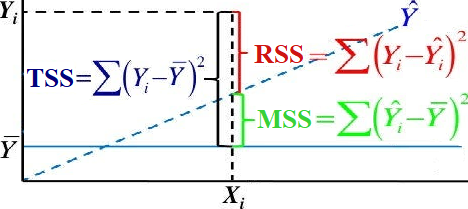
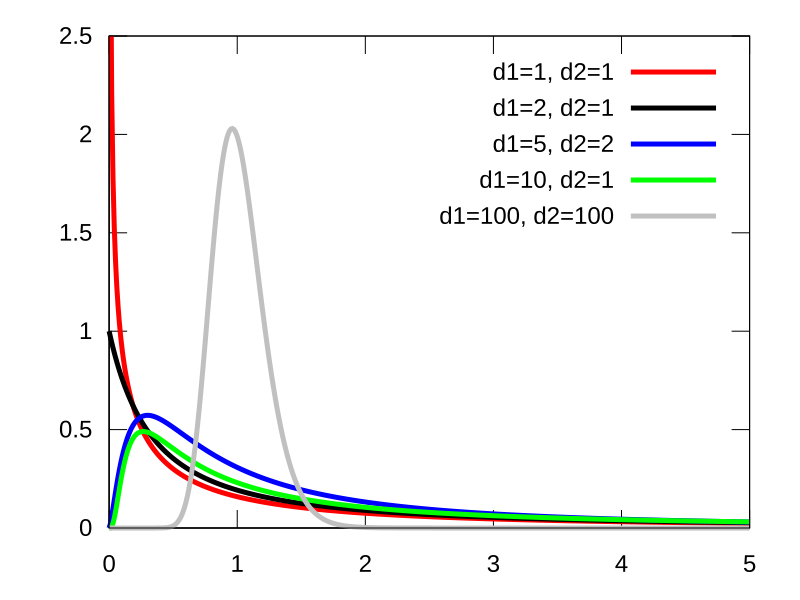

```{r setup,include=F}
knitr::opts_chunk$set(echo=T,
                      # cache=T,autodep=T,
                      fig.align='center',dev='svg')
knitr::opts_knit$set(global.par = TRUE)
library(tidyverse)
source("https://bwu62.github.io/stat240-revamp/ggplot_theme_options.R")
options(width=100)
set.seed(1)
```


## Simple linear regression (SLR) review

:::{.fragment .no-fade-in .semi-fade-out data-fragment-index=1}
Quick overview of SLR (one predictor, one response) from 240:

- Let $X$, $Y$ be numeric RVs with **clear linear relationship**; recall theoretical correlation:
  $$\rho_{X,Y}=\frac{\cov{X,Y}}{\sqrt{\v X\v Y}}$$
  In sample, we observe **sample correlation coefficient**:
  $$r=\frac{\frac1{n-1}\sum(x_i-\bar x)(y_i-\bar y)}{s_xs_y}$$
:::

:::{.fragment data-fragment-index=1 style="margin-top:-1em"}
- Note $n\!-\!1$ used in numerator instead of $n$, similar to sample SDs $s_x$, $s_y$

- $\rho$, $r$ always in $[-1,1]$, where:
  - Sign (positive/negative/zero) indicates **direction of slope** of best fit line, and
  - Absolute value indicates **strength of correlation** (closer to ±1 means stronger)

- **Note:** correlation coefficient ***assumes*** linear relationship; ***must*** be checked with plot!

- Interactive correlation demo: <https://bwu62.shinyapps.io/correlation>
:::


## SLR model

:::{.fragment .no-fade-in .semi-fade-out data-fragment-index=1}
Let $(x_i,y_i)$ be sample of size $n$ of apparently linear points. **Model equation** for SLR:
$$
y_i=\beta_0+\beta_1x_i+\ep_i
$$

- $\beta_0$, $\beta_1$ are true intercept & slope (treated as constants like $x_i$)

- $\ep_i\iid\norm{0,\sigma^2}$ are **errors** of each point (the only variable on RHS!)
:::

:::: {.columns .fragment data-fragment-index=1}

::: {.column width="40%"}
MC simulated demo:

```{r}
b0  = -3             # true intercept
b1  = 0.5            # true slope
n   = 10             # sample size
m   = 10             # min X range
M   = 20             # max X range
sig = 2              # true sigma
x   = runif(n,m,M)   # generate Xs
e   = rnorm(n,0,sig) # generate errors
y   = b0 + b1*x + e  # combine for Ys
```
:::

:::{.column width="60%"}
```{r,echo=F,fig.width=6.5,fig.height=4.5}
# pick a convenient point in quadrant IV as example
i <- which.min((scale(x)[,1]-.5)^2+(scale(y)[,1])^2)

ggplot(tibble(x,y), aes(x=x,y=y)) + geom_point() +
  geom_segment(aes(color="yi",x=x[i],y=0,yend=y[i]),linewidth=.7) + 
  geom_segment(aes(color="xi",y=y[i],x=10,xend=x[i]),linewidth=.7) + 
  geom_segment(aes(color="εi",x=x[i],y=y[i],yend=(b0+b1*x[i])),linewidth=.7) + 
  geom_point(aes(color="i-th point",x=x[i],y=y[i]),size=3,shape="square") + 
  stat_smooth(aes(color="best fit line"),method=lm,se=F,linewidth=1,linetype="dashed",fullrange=T) +
  geom_abline(aes(color="true line", slope=b1, intercept=b0),linewidth=1,key_glyph="path") + 
  scale_x_continuous(breaks=seq(10,20,2), labels=seq(10,20,2),
                     limits=c(10,20), expand=0, minor_breaks=10:20) + 
  scale_y_continuous(breaks=seq(0,10,1), labels=seq(0,10,1),
                     limits=c(0,10), expand=0, minor_breaks=NULL) + 
  scale_color_manual(breaks=c("best fit line","true line","i-th point","εi","yi","xi"),
                     values=c("#7570B3FF","#1B9E77FF","#666666FF","#E6AB02FF","#A6761DFF","#E7298AFF")) + 
  theme(legend.key.width=unit(2.1,"line")) +
  labs(color = "Legend", title = "Simulated linear model demo")
```
:::

::::


## OLS fitting

:::: {.columns .fragment .no-fade-in .semi-fade-out data-fragment-index=1}

::: {.column width="50%"}
Typically **ordinary least squares** (OLS) used to fit, i.e. **sum of squared errors** minimized. Given some $\beta_0',\beta_1'$, define OLS **loss function**:

$$
\ell(\beta_0',\beta_1')=\sum_{i=1}^n(y_i-(\beta_0'+\beta_1'x_i))^2
$$

To minimize $\ell(\beta_0',\beta_1')$, set partial derivatives vs $\beta_0'$, $\beta_1'$ to 0 and solve ([full derivation](https://statproofbook.github.io/P/slr-ols.html))
:::

:::{.column width="50%"}
{.absolute style="z-index:-1;" right=0 top=0 height="420"}
:::

::::

:::{.fragment data-fragment-index=1}
Best fit coefficients:
$$
\hat\beta_1~=~r\cdot\frac{s_y}{s_x}~~\,\\
\hat\beta_0~=~\bar y-\hat\beta_1\bar x
$$

- **Note:** equivalent to line with slope $\hat\beta_1$ passing through $(\bar x,\bar y)$

- Can be shown these estimators are [unbiased with least variance](https://en.wikipedia.org/wiki/Gauss%E2%80%93Markov_theorem)
:::


## Inference

:::{.fragment .no-fade-in .semi-fade-out data-fragment-index=1}
After fitting, our **fitted** or **predicted values** $\hat y_i$ are found by pluggin $x_i$ back:

$$
\hat y_i=\hat\beta_0+\hat\beta_1x_i
$$

Then our **residuals** $\hat\ep_i$ are the realizations of $\ep_i\sim\norm{0,\sigma^2}$, defined:

$$
\hat\ep_i=y_i-\hat y_i=y_i-(\hat\beta_0+\hat\beta_1x_i)
$$
:::

:::{.fragment data-fragment-index=1 style="margin-top:1em"}
Using these, we estimate $\sigma^2$ using the **mean squared error** of the residuals:

$$
\hat\sigma^2=\frac{\ell(\hat\beta_0,\hat\beta_1)}{n-2}=\frac{\sum\hat\ep_i^2}{n-2}=\frac1{n-2}\sum_i(y_i-(\hat\beta_0+\hat\beta_1x_i))^2
$$

Can be shown $\hat\sigma^2$ is unbiased estimator for $\sigma^2$. Note: $\sigma^2$ is important since this represents the **amount of noise** in the data. Higher $\sigma^2$ $\to$ more noise $\to$ less precise results.

Remember to check if $\hat\ep_i\sim\norm{0,\sigma^2}$ with residual plots!
:::


## SE of coefficients

:::{.fragment .no-fade-in .semi-fade-out data-fragment-index=1}
Slope SE can be easily derived now. First, note:
$$
\begin{align}
\sum(x_i-\bar x)(y_i-\bar y)&=\sum(x_i-\bar x)y_i-\bar y\cancel{\sum(x_i-\bar x)}\\
&=\sum(x_i-\bar x )(\beta_0+\beta_1x_i+\ep_i)
\end{align}
$$
:::

:::{.fragment .fade-in-then-semi-out data-fragment-index=1}
$$
\begin{align}
\v{\hat\beta_1}
&=\V{\frac{\sum(x_i-\bar x)(y_i-\bar y)}{\sum(x_i-\bar x)^2}}=\V{\frac{\sum_i(x_i-\bar x)(\cancel{\beta_0 +\beta_1x_i}+\ep_i )}{\sum (x_i-\bar x)^2}}\\
&=\frac{\sum (x_i-\bar x)^2\text{Var}(\ep_i)}{\left(\sum (x_i -
\bar x)^2\right)^2}=\frac{\sigma^2}{\sum_i (x_i-\bar x)^2}
\end{align}
$$
:::

:::{.fragment}
Then, using our sample we can estimate $\displaystyle\se(\hat\beta_1)=\sqrt{\frac{\hat\sigma^2}{s_x^2(n-1)}}$. Similar process gives:

$\displaystyle\v{\hat\beta_0}=\sigma^2\!\left[\frac1n+\frac{\bar x^2}{\sum_i (x_i-\bar x)^2}\right]$, so estimate $\displaystyle\se(\hat\beta_0)=\sqrt{\hat\sigma^2\!\left[\frac1n+\frac{\bar x^2}{s_x^2(n-1)}\right]}$
:::


## Inference on coefficients

:::{.fragment .no-fade-in .semi-fade-out data-fragment-index=1}
Coefficients $\hat\beta_0$, $\hat\beta_1$ follow T-distributions with $n\!-\!2$ degrees of freedom.

- For hypothesis testing, e.g. $H_0\!:\!\beta_1=0~$ vs $~H_a\!:\!\beta_1\ne0$, use: $$t_\obs~=~\frac{\hat\beta_1-0}{\se(\hat\beta_1)}\sim T_{n-2}$$
:::

:::{.fragment data-fragment-index=1}
- For confidence intervals, e.g. C% interval for $\beta_1$, use:
$$
\text{$C\%$ or $(1\!-\!\alpha)$ interval}~=~\hat\beta_1\pm t_{\alpha/2,\,n-2}\cdot\se(\hat\beta_1)
$$

  - $t_{\alpha/2,\,n-2}$ is T critical value, e.g. `qt(0.975,df=n-2)` for 95%

  - Can also use `confint()` function
:::


## Confidence/prediction interval for predictions

<style>#confidenceprediction-interval-for-predictions span.display mjx-container{font-size:85%!important}</style>

:::: {.columns}

Suppose we take new observation at $X=x_\new$, can make two different intervals at there:

::: {.column width="40%"}

- **Confidence interval** for mean predicted response $\hat y$ (i.e. for the regression line), which has:
$$\se(\hat y)\!=\!\sqrt{\hat\sigma^2\!\left[\frac1n\!+\!\frac{(x_\new\!-\!\bar x)^2}{s_x^2(n-1)}\right]}~~~~~$$

- **Prediction interval** for next individual data point $y_\new$ (i.e. for the data points), which has:
$$\se(y_\new)\!=\!\sqrt{\hat\sigma^2\!\left[1\!+\!\frac1n\!+\!\frac{(x_\new\!-\!\bar x)^2}{s_x^2(n-1)}\right]}~~~$$

:::

:::{.column width="60%"}

{.absolute style="z-index:-1;" right=-10 top=150 height="400"}

:::

::::

- Can also use &nbsp; `predict(lm.object, interval="confidence")` &nbsp; or &nbsp; `"prediction"`


## Extrapolating

<center>{height="442px"}</center>

<small>source: <https://xkcd.com/605/></small>


## Cumulative SLR exercise!

```{r,echo=F}
set.seed(340)
n = 30 ; b1 = 4 ; b0 = -8 ; s = 6
x = round(runif(n,10,20),1)
y = round(b0 + b1*x + rnorm(n,0,s),1)
```

Suppose you have the following observations:

>     x = c(`r toString(x)`) 
>     y = c(`r toString(y)`)

Do the following (try both manually and using R functions):

1. Plot the data, check if SLR is appropriate, and find the correlation $r$,

2. Fit a best fit line, plot it, and find the coefficients $\hat\beta_1$, $\hat\beta_0$,

3. Find the fitted values $\hat y_i$ and residuals $\hat\ep_i$, and check model assumptions,

4. Estimate SD of errors $\sigma$ and SEs of coefficients $\hat\beta_1$, $\hat\beta_0$,

5. Find p-value for testing $\beta_1\!=\!0$ vs not, and give 95% CIs for $\beta_1$, $\beta_0$,

6. At $X\!=\!18$, give and interpret 95% confidence and prediction intervals.

Answers using R functions shown first:


## Exercise answers using R functions

```{r,fig.show='hold',fig.width=5,fig.height=3}
# plot data, best fit line, and find correlation
ggplot(tibble(x,y),aes(x,y)) + geom_point() + geom_smooth(method=lm,se=F)
cor(x,y)
```


## Exercise answers using R functions (cont.)

```{r}
# fit with lm(), print summary with coefficients, SEs, and residual SE
# also shows coefficient p-values for testing each =0 vs ≠0
model = lm(y ~ x, data = tibble(x,y))
summary(model)
```


## Exercise answers using R functions (cont.)

```{r,include=F}
par(mar=c(3,3,3,2),mgp=c(2,.6,0))
```

```{r}
# fitted values
fitted(model) %>% unname %>% round(2)
# residuals
resid(model) %>% unname %>% round(2)
# check model
par(mfrow=c(1,2))  ;  plot(model,which=1:2)
```


## Exercise answers using R functions (cont.)

```{r}
# confidence intervals for coefficients
confint(model, level = 0.95)
# confidence/prediction intervals for prediction at new X=18
predict(model, newdata = data.frame(x=18), interval = "confidence")
predict(model, newdata = data.frame(x=18), interval = "prediction")
```

Answers using manual computation shown on next slides:


## Exercise answers computing manually

```{r}
# define useful values
n = length(x) ; mx = mean(x) ; my = mean(y) ; sx = sd(x) ; sy = sd(y) ; r = cor(x,y)
# best fit slope and intercept
c(b1 <- r*sy/sx, b0 <- my-b1*mx)
# fitted and residual values
fitted = b0 + b1*x  ;  resid = y - fitted
# residual standard error
(sigma.hat = sqrt(sum(resid^2)/(n-2)))
# estimated SE of coefficients
(se.b1 = sigma.hat*sqrt(1/(sx^2*(n-1))))
(se.b0 = sigma.hat*sqrt(1/n+mx^2/(sx^2*(n-1))))
# test true slope =0 vs ≠0
(b1.stat = b1/se.b1)
(b1.pval = 2*pt(-abs(b1.stat), df=n-2))
```


## Exercise answers computing manually (cont.)

```{r}
# confidence intervals for both coefficients
(t.crit = qt(0.975, df=n-2))
(b1 + c(-1,1)*t.crit*se.b1)
(b0 + c(-1,1)*t.crit*se.b0)
# confidence/prediction intervals for prediction at new X=18
(y.new = b0 + b1*18)
(se.conf = sigma.hat*sqrt(1/n+(18-mx)^2/(sx^2*(n-1))))
(se.pred = sigma.hat*sqrt(1+1/n+(18-mx)^2/(sx^2*(n-1))))
(y.new + c(-1,1)*t.crit*se.conf)
(y.new + c(-1,1)*t.crit*se.pred)
```


## Verify SEs with MC

Can verify the coefficient SEs with MC:

```{r}
# use same X vector
x = c(14.4,15.3,11.2,10.7,11.9,13,18.4,15.3,17.3,10.1,18.4,18.1,16.6,15.7,10.3,
      19,10.9,16.3,17,17.2,14.3,12.3,15.8,17.8,15.2,20,11.1,18.3,15.9,12.1)
n = length(x)

# previous y points generated with:
b1 = 4 ; b0 = -8 ; sigma = 6

# generate many new samples, fit, and extract coefficients
betas = replicate(1e4, coef(lm(b0 + b1*x + rnorm(n,0,sigma) ~ x)) )
b0s = betas[1,] ; b1s = betas[2,]
c(mean(b0s), mean(b1s))

# empirical SEs
c(sd(b0s), sd(b1s))

# theoretical values
sigma * sqrt(1/n + mx^2/(sx^2*(n-1)))
sigma * sqrt(1/(sx^2*(n-1))) 
```


## How "good" is fit?

:::{.fragment .no-fade-in .semi-fade-out data-fragment-index=1}
Often how "good" a fit is can have 2 different interpretations:

- Is the model **appropriate** for the data? I.e. is the linear model assumption correct?

  - Answered by checking residual plots: are they normal, 0-mean, constant variance?
:::

:::{.fragment .fade-in-then-semi-out data-fragment-index=1 style="margin-top:-.5em"}
- Alternatively, can ask how **predictive** is model? I.e. is $X$ predicting $Y$ well?

  - Often answered with **coefficient of determination** $R^2$, which $=(r)^2$ [for SLR](https://statproofbook.github.io/P/slr-rsq.html)
  
  - Formal definition: recall data composed of "signal" and "noise" components; after fitting,  
    **Total** variability of reponse, $~\tss=\sum(y_i-\bar y)^2~$ (also SST) [partitioned into](https://statproofbook.github.io/P/slr-pss.html):
    
    i) Portion explained by **Model** $~\mss=\sum(\hat y_i-\bar y)^2~$ (also ESS or SSR)
    ii) **Residuals** portion not explained by model $~\rss=\sum(y_i-\hat y_i)^2~$ (also SSE or SSR)
:::

:::: {.columns .fragment}

::: {.column width="30%"}

$$
~~~~~R^2=\frac{\tss-\rss}\tss=\frac\mss\tss\\[6pt]=1-\frac\rss\tss~~~~~~
$$

:::

:::{.column width="70%"}

{style="float:right;z-index:-1" height="240"}

:::

::::


## R^2^ example

For previous fit,

```{r}
# print portion of summary table
summary(model)  %>% capture.output %>% tail(-8) %>% cat(sep="\n")
# compute R² from formula
1-sum(resid(model)^2)/(sy^2*(n-1))
# compare with correlation²
r^2
```

Interpretation: about `r round(r^2*100)`% of variation in Y explained by variation in X


## Multiple linear regression (MLR)

:::{.fragment .no-fade-in .semi-fade-out data-fragment-index=1}
Generally speaking, MLR same as SLR but with more terms. Model equation:

$$
y_i=\beta_0+\beta_1x_{i,1}+\beta_2x_{i,2}+\cdots+\beta_px_{i,p}+\ep_i
$$

- $\beta_0$, $\beta_1$, ..., $\beta_p$ are true intercept & slopes (still constants like all $x_{i,j}$)

- $\ep_i\iid\norm{0,\sigma^2}$ are **errors** of each point (still the only variable on RHS!)

- Still usually fit with OLS, i.e. make squares of distances from points as small as possible

- Derivation arguably simpler than SLR ([details here](https://pages.stat.wisc.edu/~bwu62/mlr_derivation))
:::

:::{.fragment .fade-in-then-semi-out data-fragment-index=1}
Only some key differences in MLR:

- Degrees of freedom: $n-(p+1)$, one for each coefficient (note $p=1$ gives SLR's $n-2$)

- Coefficients interpreted as expected change in $Y$ **while holding other variables constant**

  - MLR naturally attempts to attribute changes in $Y$ associated with each variable
  
  - Useful to account/control for other influencing variables
  
  - Downside: predictors should not be strongly correlated, i.e. **multicollinearity** (can use statistics like [VIF](https://www.sthda.com/english/articles/39-regression-model-diagnostics/160-multicollinearity-essentials-and-vif-in-r) to detect)
:::


## MLR exercise

<style>#multiple-linear-regression-mlr span.display mjx-container{font-size:100%!important;padding:0!important;}</style>

:::{.fragment .no-fade-in .semi-fade-out data-fragment-index=1}
Fitting in R: simply add more variables to `y ~ var1 + var2 + ...` formula in `lm()` call

Exercise: recall `mtcars` which contains fuel efficiency data for several cars, fit an MLR model predicting `qsec` using `disp`, `hp`, and `wt`. Show summary, interpret coefficients values + significances briefly, check residuals, and find 95% confidence intervals for coefficients.
:::

:::{.fragment .fade-in-then-semi-out data-fragment-index=1 style="margin-top:1em"}
```{r}
model.mtcars = lm(qsec ~ disp + hp + wt, data = mtcars)
summary(model.mtcars)  %>% capture.output %>% tail(-8) %>% cat(sep="\n")
```

Interpretation, e.g. for `disp`: for each unit increase in displacement, qsec-time expected to drop by 0.0066 on average, **holding other variables constant**. Controlling for other variables, displacement not significant at $\alpha=0.05$ ($p=0.12$)
:::


## MLR exercise (cont.)

```{r,include=F}
par(mfrow=c(1,2),mar=c(3,3,3,2),mgp=c(2,.6,0))
```
```{r}
confint(model.mtcars)
plot(model.mtcars, which=1:2)
```


## MLR exercise (cont.)

:::{.fragment .no-fade-in .semi-fade-out data-fragment-index=1}
For MLR, $R^2$ still defined as $1-\rss/\tss$, but no longer interpretable as square of a correlation coefficient, since correlation only defined for two variables.

For previous exercise, compute and interpret $R^2$ using residuals.
:::

:::{.fragment data-fragment-index=1 style="margin-top:1em"}
```{r}
# extract from summary output
summary(model.mtcars)$r.squared
# compute manually
1-sum(resid(model.mtcars)^2)/(var(mtcars$qsec)*(nrow(mtcars)-1))
```

Interpretation: about `r round(summary(model.mtcars)$r.squared*100)`% of variation in qsec-time explained by variations in displacement, horsepower, and weight of cars.
:::


## Overall model F-test

:::{.fragment .no-fade-in .semi-fade-out data-fragment-index=1}
Another way of assessing model significance: look at F-statistic, which is defined:
$$
F_\obs=\frac{\mss/p}{\rss/(n-(p+1))}
$$
and tests against the null model in the null hypothesis:
$$
H_0 : \beta_1 = \beta_2 = \cdots = \beta_p = 0,
$$
vs $H_a:$ at least one $\beta_i\neq0$, i.e. tests entire model useless vs not useless.
:::

:::{.fragment data-fragment-index=1 style="margin-top:1em"}
F-statistic follows F-distribution with $p$, $n\!-\!(p\!+\!1)$ DFs. For 340, just interpreting output of summary is sufficient:

```{r}
summary(model.mtcars)  %>% capture.output %>% tail(4) %>% cat(sep="\n")
```

$F=19.91~$ on 3, 28 DF, $~p=4.1\!\times\!10^{-7}\!\ll\!0.05$, very significant vs null model
:::


## $F$-distribution examples

<center>{width="70%"}</center>


## Additional predictor types

In MLR, there are often many other types of predictors we can consider adding to the model. We will examine 3 main types:

 - Categorical variables
 
   - Examples: Control/treatment, male/female, high/medium/low, etc.

 - Interactions
 
   - When two variables (numeric or categorical) have additional combined effects, i.e. "synergy"

 - Non-linear terms
 
   - When a function of a variable is better modeled as linear vs response

Additional predictors can be added to model with same syntax `y ~ var1 + var2 + ...`


## Categorical predictors

:::{.fragment .no-fade-in .semi-fade-out data-fragment-index=1}
For categorical predictors with 2 or more **levels** (or categories), the following is done:

 1. One level is **taken as the reference level**, (or baseline),
 
 2. The difference between **every other level _vs the reference_** is then individually modeled as a **slope on an indicator variable** (i.e. 1/0) for that level,

 3. These slopes are shown as coefficients (note: the **reference is NOT shown** as a slope!)
:::

:::{.fragment data-fragment-index=1 style="margin-top:.5em"}
Example: for `iris` dataset below, `Species` is categorical with 3 levels:
```{r}
str(iris)
# model predicting Sepal.Length from all other variables:
# alternative: lm(Sepal.Length ~ . , data=iris) where . means all other columns
model.iris = lm(Sepal.Length ~ Sepal.Width + Petal.Length + Petal.Width + Species, data=iris)
```
:::


## Iris example (cont.)

::::{.columns}

:::{.column style="width:68%;padding-right:20px!important;"}
```{r}
summary(model.iris)
```
:::

:::{.column style="width:30%"}

- Note: setosa used as reference (not shown), other species vs setosa fitted as coefficients

- I.e. **all else equal**, versicolor sepal length lower vs setosa by 0.72cm **on average**

- Both species **significantly different** vs setosa (note: versicolor vs virginica difference NOT modeled & may not be significant)

- To change reference, mutate variable with [`fct_relevel()`](https://forcats.tidyverse.org/reference/fct_relevel.html)  
  
  ([*demo*](https://empirical-methods.com/predictive-regression-part-i.html#dummy-variables-with-lm))

:::

::::


## Categorical variables (cont.)

Sometimes, categorical variables may already be coded as 1/0 indicator variables, in this case add them in as normal and the coefficient shown is the **difference of 1 vs 0 levels**. Example with `mtcars` again:

```{r}
# update previous mtcars model by adding am, vs categorical variables
# alternative: model.mtcars2 = update(model.mtcars, . ~ . + am + vs)
model.mtcars2 = lm(qsec ~ disp + hp + wt + am + vs, data = mtcars)
summary(model.mtcars2)  %>% capture.output %>% tail(-8) %>% cat(sep="\n")
```

I.e. **all else equal**, manual transmission faster vs automatic in qsec time by 0.8s **on average**, but this observed difference is only **weakly significant** ($p\approx0.09$).


## Practice exercise

```{r}
str(penguins)
```

:::{style="margin-top:1em"}

With the build-in `penguins` dataset (shown above), do the following:

1. Use species, bill length, bill depth to linearly predict flipper length.

2. Give a full \& clear interpretation of **each coefficient** (both slope \& significance).

3. Is the overall model significant? Give a statistic \& p-value.

4. What amount of the variation in flipper length is explained by your model?

5. Predict flipper length for an Adelie penguin with 40mm bill length and 20mm bill depth.

6. Run model diagnostics (i.e. check residual assumptions).
:::


## Penguins exercise answers  {transition="slide-in fade-out"}

```{r}
model.penguins = lm(flipper_len ~ species + bill_len + bill_dep, data=penguins)
summary(model.penguins)  %>% capture.output %>% tail(-8) %>% cat(sep="\n")
```

- Bill length found to be **highly significant** ($p\approx10^{-8}$). **All else equal**, each 1mm increase in bill length associated with 0.70mm increase in flipper length **on average**.

- **All else equal**, Gentoo penguins' flipper lengths found to be **highly significantly** different vs Adelies ($p<10^{-15}$) averaging 27.6mm longer, but Chinstraps not found to be significant ($p\approx0.37$) averaging only -1.3mm shorter.


## Penguins exercise answers (cont.)  {transition="fade-in slide-out"}

```{r}
model.penguins = lm(flipper_len ~ species + bill_len + bill_dep, data=penguins)
summary(model.penguins)  %>% capture.output %>% tail(-8) %>% cat(sep="\n")
```

- Overall model highly significant vs null ($F\!=\!464.7$ on 4, 337 DFs, $~p\!<\!10^{-15}$).

- About 85% of variation in flipper length explained by model.


## Penguins exercise answers (cont.)

```{r}
# prediction using predict() function
predict(model.penguins, tibble(species="Adelie",bill_len=40,bill_dep=20))
# manual prediction
coef(model.penguins)
sum(coef(model.penguins) * c(1, 0, 0, 40, 20))
plot(model.penguins, which=1:2)
```


## Interactions

:::{.fragment .no-fade-in .semi-fade-out data-fragment-index=1}
Interaction effects are when **two (or more) predictor variables** have a combined **synergistic effect**, i.e. there's a "pairing" effect, or alternatively "the whole is greater or less than the sum of the parts"

Mathematically, it's equivalent to fitting a **slope for the product** of the variables.

Note: if a categorical variable is used in the interaction term, **each non-reference level** is **considered separately** in the product
:::

:::{.fragment data-fragment-index=1}
Example: consider the `iris` dataset again, suppose we wish to see if it's worth adding an interaction effect. We can make an **interaction plot** where the response is simultaneously plotted against BOTH predictors in question.

```{r}

```

:::


##

*(more notes added soon)*
