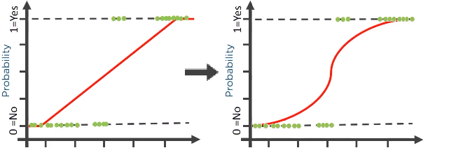

```{r setup,include=F}
knitr::opts_chunk$set(echo=T,
                      # cache=T,autodep=T,
                      fig.align='center',dev='svg')
knitr::opts_knit$set(global.par = TRUE)
library(tidyverse)
source("https://bwu62.github.io/stat240-revamp/ggplot_theme_options.R")
options(width=100)
set.seed(1)
```


## Logistic regressions

:::{.fragment .no-fade-in .semi-fade-out data-fragment-index=1}
What if response variable is binary categorical? E.g. yes/no, success/failure, A/B.

 - Can represent responses as 1/0 and consider regressing **probability of 1 (success)**, but need prediction to be constrained to [0,1]
 
 - Direct SLR/MLR not suitable since predicted response can NOT be limited to [0,1]
 
 - Solution: fit **transformation of predicted probability of 1** with output range in [0,1]

 - Most commonly, we fit **logistic function**---i.e. **log-odds**---of estimated probability of 1
:::

:::{.fragment data-fragment-index=1}
<center>{width="90%"}</center>
:::


## Probability, odds, log odds


::::: {.columns}

:::: {.column width="55%"}

<style>#mermaid-1{max-width:98%!important}.labelBkg{background-color:rgba(255,255,255)!important;border: 3px solid white;}</style>
```{mermaid}
flowchart TD
 P(Probability $$~P$$) --> |"$$\frac{P}{1-P}$$"| O(Odds $$~O$$)
 P --> |"$$\log(\frac{P}{1-P})$$"| L(Log-odds $$~L$$)
 O --> |"$$\log(O)$$"| L
 L --> |"$$\exp(L)$$"| O
 O --> |"$$\frac{O}{1+O}$$"| P
 L --> |"$$\frac{1}{1+\exp(-L)}$$"| P
```

::::

::::{.column width="45%"}

:::{.fragment .no-fade-in .semi-fade-out data-fragment-index=1}
 - Probability $\;P:~~[~\,0~\longleftarrow0.5\longrightarrow\,1~]$

 - Odds $~~~~~~~\,O:~~[~\,0~\longleftarrow\;1\,\longrightarrow\infty\,)$

 - Log-odds $~~~\,L:~(-\infty\longleftarrow0\,\longrightarrow\infty\,)$

 - Odds are **multiplicative**, but log-odds are **additive**, increase in log-odds means increase in probability \& vice versa
:::

:::{.fragment data-fragment-index=1}
Also note, **logistic function** refers to:

$$
f(x)=\frac1{1+\exp(-x)}~~
$$

and its inverse, called **logit function**:

$$
f^{-1}(x)=\log\left(\frac{x}{1-x}\right)~~
$$

Note: don't forget sign in $\exp(-x)$ term
:::

::::

:::::


## Logistic regression model

:::{.fragment .no-fade-in .semi-fade-out data-fragment-index=1}
For each predictor value $x$, suppose the true probability of 1 there, $p(x)$ is:

$$
p(x)=\frac1{1+\exp[-(\beta_0+\beta_1x)]}
$$
Note this is equivalent to:
$$
\log\left(\frac{p(x)}{1-p(x)}\right)=\beta_0+\beta_1x
$$
:::

:::{.fragment data-fragment-index=1}
- Best fit $\hat\beta_0$, $\hat\beta_1$ are found numerically (no closed form solution), [demo](https://www.desmos.com/calculator/ursoryiern)

  - Can be easily extended to MLR by adding $\,{}+\beta_2x_{i,2}+\cdots+\beta_px_{i,p}$

  - Can of course add categoricals, interactions, nonlinear terms, etc..

- Thus, logistic regression equivalent to **SLR/MLR** with **log-odds of 1 as response**.

- This means **coefficients** in summary table correspond to **log odds**, i.e:

  - Intercept is estimated baseline log-odds of 1 at $x=0$,
  
  - Slope is estimated increase in log-odds for each 1 unit increase in $x$
:::


## Important differences

<style>#important-differences li{margin:.5em 0 1em}</style>

:::{.fragment .no-fade-in .semi-fade-out data-fragment-index=1 style="margin-top:.5em"}
Besides transforming to log-odds, there are some other differences:

 - Logistic regression usually [fitted by MLE](https://en.wikipedia.org/wiki/Logistic_regression#Model_fitting) (maximum likelihood estimation), not OLS
 
 - Logistic regression is a [type of GLM](https://en.wikipedia.org/wiki/Generalized_linear_model) (generalized linear model), where transformation of mean is fitted to predictors
:::

:::{.fragment data-fragment-index=1 style="margin-top:.5em"}
 - For logistic regression, equation directly models mean log-odds with predictors, not each individual 1/0 $y_i$ response, so **no error $\ep_i$ terms**
 
   - Thus, **residuals NOT assumed to be N(0,σ²)**, and are not important to us

 - When predicting, use coefficients similarly to MLR to get **predicted log-odds of 1**, then can convert to probability if desired

 - In summary, all statistics are Z-based (i.e. normal) instead of T-based
 
   - I.e. instead of T-tests and T-intervals, do the equivalent Z-tests and Z-intervals
:::


## Example: Credit `Default` dataset

:::{.fragment .no-fade-in .semi-fade-out data-fragment-index=1}
The `ISLR2` dataset `Default` contains (simulated) credit default data of customers:

```{r}
# shuffle rows to better show categorical levels, then save and preview
Default = slice_sample(ISLR2::Default, prop=1)  ;  str(Default)
head(Default, 3)
```
:::

:::{.fragment data-fragment-index=1}
Let's predict which customers default, i.e. do not pay loans back, letting 1 be defaults

```{r}
# convert default factor to 1/0
Default$default = ifelse(Default$default == "Yes", 1, 0)
head(Default, 3)
```
:::


## Example: Credit `Default` dataset (cont.)

```{r,fig.width=8,fig.height=6,dev="png"}
GGally::ggpairs(ISLR2::Default,aes(color=student,alpha=.9)) # quick plot
```


## Example: Credit `Default` dataset (cont.)

:::{.fragment .no-fade-in .semi-fade-out data-fragment-index=1}
```{r}
# fit logistic model with glm(), remember to have family=binomial!!
glm.default = glm(default ~ . , data=Default, family=binomial)
# only print important rows, note deviance is a loss metric, but we won't worry about it
summary(glm.default)  %>% {capture.output(.)[5:12]} %>% cat(sep="\n")
```
:::

:::{.fragment data-fragment-index=1 style="margin-top:1em"}
Interpretations:

 - All else equal, **non-students \& high-balances** both significantly **higher risk** of default
   - Non-students with 0 balance \& income very low risk of default (log-odds ≈ –1.1×10^1^)
   - All else equal, being **student decreases** log-odds of default by **–6.5×10^–1^**
   - All else equal, every \$1 remaining **balance increases** log-odds of default by **5.7×10^–3^**
   - Income not significant at all, accounting for other variables
:::


## Exercise

Suppose we have a student with \$2000 balance and \$15,000 income. What are the predicted **log-odds**, **odds**, and **probability** of defaulting? Compute both manually \& in R.

:::{.fragment style="margin-top:1em"}
Answer:
```{r}
# log-odds of defaulting = intercept + student coef + (2000 * balance coef) + (15000 * income coef)
(L = -1.087e1 + -6.468e-1 + 2000*5.737e-3 + 15000*3.033e-6)
(O = exp(L))         # odds of defaulting
(P = O/(1+O))        # probability of defaulting
(P = 1/(1+exp(-L)))  # alternative formula for p
# use R to predict, note by default R gives log-odds!  see help page of predict.glm() for details
predict(glm.default, newdata = tibble(student="Yes", balance=2e3, income=1.5e4))                     %>% unname
# tell R to output prediction as probability instead
predict(glm.default, newdata = tibble(student="Yes", balance=2e3, income=1.5e4), type="response")    %>% unname
```
:::


## Testing table revisited:  {transition="slide-in fade-out"}

Next, can take predicted probabilities above a threshold (often 0.5) as predicted 1, otherwise 0. These can be compared to true 1/0 values to get **confusion matrix**:

```{r confusion}
# easy R method: first get vector of true 1/0 values and convert to factor, a type of categorical representation
true.responses = Default$default %>% as.factor
# then, threshold predictions and convert first to numeric 1/0 values then to factor as well
pred.responses = (predict(glm.default,type="response") > 0.5) %>% as.numeric %>% as.factor

# use confusionMatrix() from caret package, set predicted/true values and what's "positive"
caret::confusionMatrix(data=pred.responses, reference=true.responses, positive="1") %>%
  {capture.output(.)[c(1:8,17:21)]} %>% cat(sep="\n")
```


## Testing table revisited:  {transition="fade-in slide-out"}

:::::: {.columns}

::::: {.column width="65%"}

:::{.fragment .no-fade-in .semi-fade-out data-fragment-index=1}
 - Prediction 1 is positive, prediction 0 is negative
 - If prediction = reference, then true, else false
 - Thus TN=9627, FN=228, FP=40, TP=105
:::

:::{.fragment .fade-in-then-semi-out data-fragment-index=1}
In table below confusion matrix,

 - Accuracy (% pred. correct) = (TP+TN)/(TP+TN+FN+FP)
 - Sensitivity (also power or TP rate) = TP/(TP+FN)
:::

:::::

:::::{.column width="35%"}
```{r,ref.label='confusion',echo=F}
```
:::::

::::::

::::{style="margin-top:-.8em"}

:::{.fragment .fade-in-then-semi-out data-fragment-index=1}
 - Specificity (also TN rate or $1-\alpha$) = TN/(TN+FP)
   - Note: this means $\alpha=$ 1---TN/(TN+FP) = FP/(TN+FP)
:::

:::{.fragment}
 - Positive predictive value (also precision) = TP/(TP+FP)
   - This is probability that a prediction of 1 is correct
 - Negative predictive value = TN/(TN+FN)
   - This is probability that a prediction of 0 is correct
 - Prevalence (% of 1s in population) = (TP+FN)/(TP+FN+TN+FP)
:::

::::


## Exercise

Consider confusion matrix below for predicting diabetes in the Pima Indians dataset. Compute accuracy, sensitivity, specificity, PPV, NPV, and prevalence.

````
            No diabetes Yes diabetes
  Predict 0         200           53
  Predict 1          23           56
````

:::{.fragment style="margin-top:.5em"}
```{r}
TN = 200 ; FN = 53 ; FP = 23 ; TP = 56
(accuracy = (TP+TN)/(TP+TN+FP+FN))  
(sensitivity = TP/(TP+FN))
(specificity = TN/(TN+FP))
(PPV = TP/(TP+FP))
(NPV = TN/(TN+FN))
(prevalence = (TP+FN)/(TP+FN+TN+FP))
```
:::


## ROC curve

:::{.fragment .no-fade-in .semi-fade-out data-fragment-index=1}
Receiver Operating Characteristic (ROC) curve visualizes model stats **across all thresholds** not just 0.5. For each threshold, **sensitivity vs specificity** plotted.

```{r,include=F}
library(pROC)
pred.probabilities = predict(glm.default,type="response")
```
```{r roc,eval=F,echo=T}
# easiest way in R: use roc(), plot.roc() functions from pROC package
library(pROC)
pred.probabilities = predict(glm.default,type="response")
roc(true.responses, pred.probabilities) %>% plot.roc
```
:::

:::: {.columns}

::: {.column width="50%" .fragment data-fragment-index=1 style="margin-top:.5em"}

 - More ROC curve "arches" into top left corner, the better the model is
 
   - Null model represented by 45° angle line
 
 - Entire Area Under Curve (AUC) equals chance model can distinguish a 1 vs a 0

   - AUC = 0.5 for null model
   - AUC = 1 for perfect model

```{r}
auc(true.responses, pred.probabilities)
```

 - Nice shiny [demo](https://www.statlab.wisc.edu/shiny/bwu62/340/logistic) with Pima Indians dataset
:::

:::{.column width="50%" .fragment .no-fade-in .semi-fade-out data-fragment-index=1}
```{r,ref.label='roc',echo=F,fig.width=5,fig.height=5}
```
:::

::::

