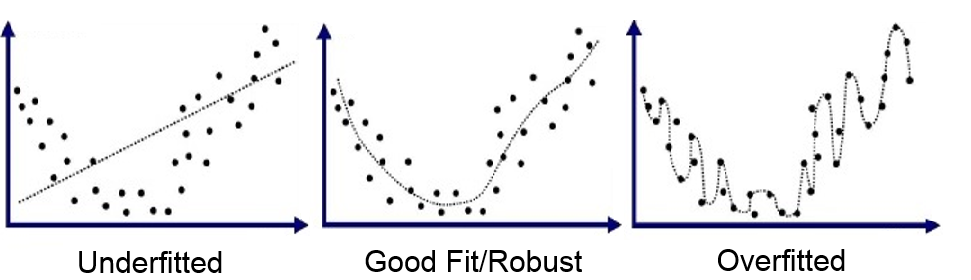
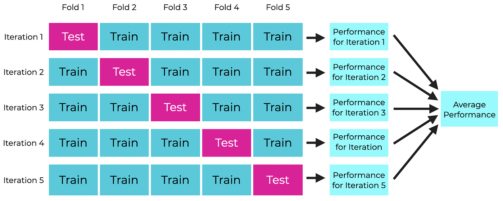
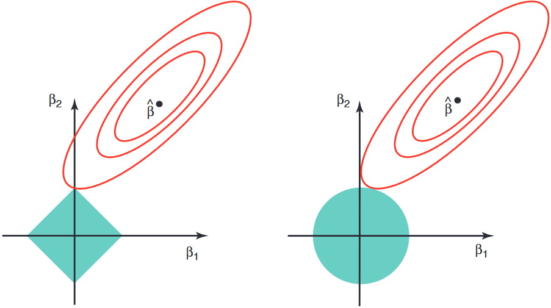

```{r setup,include=F}
knitr::opts_chunk$set(echo=T,
                      # cache=T,autodep=T,
                      fig.align='center',dev='svg')
knitr::opts_knit$set(global.par = TRUE)
library(tidyverse)
library(MASS)
source("https://bwu62.github.io/stat240-revamp/ggplot_theme_options.R")
options(width=100)
set.seed(2)
```


## Over/underfitting

In modeling, the more complex a model, the more prone to **overfitting** it is

 - More parameters in model to estimate means more complex shape
 
 - If shape too complex, model may start to "memorize" your dataset, which impacts inference and generalizability
 
 - To avoid overfitting, need good, robust metrics to detect \& discourage overfitting

<center>{width="90%"}</center>


## RSS \& overfitting

:::{.fragment .no-fade-in .semi-fade-out data-fragment-index=1}
Note: adding new parameters **_always_ lowers training RSS**, even if they're useless!

 - Suppose you add some ${}+\beta_p\,x_{i,p}\,$ term to a model and refit,
 
 - The new RSS can NOT be higher (i.e. worse) than the original RSS since we can always choose $\hat\beta_p=0$, which ignores the new term and should give the original fit
 
 - In theory RSS could stay exactly the same, but in practice RSS always slightly decreases
 
 - Recall R²=1--RSS/TSS, thus **R² always increases** when parameters added
:::

:::{.fragment data-fragment-index=1}
```{r}
# example: start with previous mtcars model for qsec
model.mtcars = lm(qsec ~ disp + hp + wt, data = mtcars)
summary(model.mtcars)$r.squared
# now, add a bunch of garbage randomly generated columns
model.garbage = update(model.mtcars, . ~ . + rnorm(32))
summary(model.garbage)$r.squared
```
:::


## Train/test split

:::{.fragment .no-fade-in .semi-fade-out data-fragment-index=1}
Easy \& **model-agnostic** way to robustly evaluate performance: use a **train/test split**!

 - Split data into portion only **used for training** and portion only **used for testing**
 
   - 80/20 is most common ratio used, but can choose any
 
 - Train different models on training set, then compare statistics using testing set
 
   - Avoids "memorizing" dataset since **testing data NOT seen by model during training**!
 
 - Doesn't care about type of model used, since it's a data-level approach
:::

:::{.fragment data-fragment-index=1}
```{r}
# example with iris, create 80/20 train test split
train.rows = sample(nrow(iris), nrow(iris)*0.8)
iris.train = iris[train.rows,] ; nrow(iris.train)
iris.test = iris[-train.rows,] ; nrow(iris.test)
# don't forget the , inside [] when splitting!!
# now can take this and train/test any models you want
```
:::


## Train/test split example cont.

```{r}
# define two models to compare and fit on training data
model1 = lm(Sepal.Length ~ . , data = iris.train)
model2 = lm(Sepal.Length ~ . + Petal.Length:Petal.Width, data = iris.train)

# model training MSE appears to decrease, but is it reliable?
# note RSS must be divided by model DF to get correct training MSE
sum(resid(model1)^2)/model1$df.residual
sum(resid(model2)^2)/model1$df.residual

# compute MSE using testing dataset instead for objectivity
# here, no loss of DF since new data, so mean() used instead
mean((predict(model1,iris.test) - iris.test$Sepal.Length)^2)
mean((predict(model2,iris.test) - iris.test$Sepal.Length)^2)
```


## Exercise!

Let's revisit the Pima Indians diabetes dataset from the `MASS` package. The data is split across `Pima.tr` and `Pima.te` dataframes. For some reason, the train.test split used is 38/62 which is unusual. Do the following:

1. Combine `Pima.tr` and `Pima.te` using `rbind()`, do any necessary tidying (e.g. convert diabetes `"Yes"/"No"` to 1/0), then re-split into 80/20 train/test sets.

2. Fit a model with your choice of predictors on the training set and print the summary table.

3. Using the testing set, compare your model's predictions to the actual values. Using the standard 0.5 threshold, report the following for your model:
   - Confusion matrix,
   - Accuracy, sensitivity, specificity
   - ROC curve and AUC score

4. If you have time, try to improve your model by changing the predictors used!


## Exercise answers

```{r}
# combine, process, resplit
pima = rbind(Pima.tr, Pima.te) %>% mutate(type = ifelse(type=="Yes",1,0))
train.rows = sample(nrow(pima), nrow(pima) * 0.8)
pima.train = pima[train.rows,]
pima.test = pima[-train.rows,]

# my lazy choice of model: type ~ .
glm.pima = glm(type ~ . , data = pima.train, family = binomial)
summary(glm.pima) %>% {capture.output(.)[5:14]} %>% cat(sep="\n")
# define true responses, predicted probabilities, thresholded 1/0 responses
true.type = pima.test$type %>% as.factor
pred.prob = predict(glm.pima,pima.test, type="response")
pred.type = (pred.prob > 0.5) %>% as.numeric %>% as.factor
```

## Exercise answers (cont.)

```{r}
caret::confusionMatrix(pred.type, true.type, positive="1") %>%{capture.output(.)[c(3:8,17:18)]}%>%cat(sep="\n")
library(pROC) ; auc(true.type, pred.prob)
par(pty='s') ; roc(true.type, pred.prob) %>% plot.roc
```


## Cross-validation

:::{.fragment .no-fade-in .semi-fade-out data-fragment-index=1}
For small datasets, single train/test split can vary a lot run to run depending on exact rows chosen. To improve robustness, **cross-validation** (CV) commonly used.

 - CV is a category of resampling techniques where different splits of a dataset are rotated through training \& testing roles
 
 - Uses dataset more fully, while still useful for managing overfitting
 
 - Many types of CV, e.g. [K-fold CV](https://brianreedpowers.github.io/stat340/cv.html#the-happy-medium-k-fold-cross-validation) which we will discuss in more detail, [leave-one-out CV](https://brianreedpowers.github.io/stat340/cv.html#reducing-the-variance-leave-one-out-cross-validation) (assigned reading!), etc..
:::

:::{.fragment data-fragment-index=1}
Most popular method is **K-fold CV**, where:

1. Randomly split data into $K$ different **folds** (K=5,10 commonly used),

2. Each fold takes turns being the "testing" set while the rest are used for training,

3. Finally, performance score (e.g. MSE) from each iteration averaged to get overall score.

Diagram shown on next page for $K=5$
:::

## 5-fold CV diagram

<br/>

<center>{width="100%"}</center>


## K-fold CV example

Revisiting `mtcars`, which is a small dataset with 32 rows, let's use 4-fold CV to get a good MSE estimate of the `qsec ~ disp + hp + wt` model.

```{r}
# split manually, fit each, get MSEs
n = nrow(mtcars)  ;  k = 4  ;  MSEs = rep(NA,k)  ;  folds = split(sample(n), 1:k)
for(i in 1:k){
  model = lm(qsec ~ disp + hp + wt, data = mtcars[-folds[[i]],])
  pred.qsec = predict(model,mtcars[folds[[i]],])
  true.qsec = mtcars[folds[[i]],]$qsec
  MSEs[i] = mean((pred.qsec - true.qsec)^2)
}
MSEs
# overall averaged MSE
mean(MSEs)
# quick & dirty R way using lmvar package, now archived but installable with:
# source("https://pages.stat.wisc.edu/~bwu62/install_lmvar.R")
library(lmvar)
cv.lm(lm(qsec~disp+hp+wt, data=mtcars, x=T,y=T), k=4)$MSE$mean
```

Exercise: repeat the above with a different set of predictors, can you do better?


## Other statistics: Adjusted R², AIC, BIC

:::{.fragment .no-fade-in .semi-fade-out data-fragment-index=1}
In some cases, it may be easier to compare models using certain readily computed statistics. We'll cover 3 common ones: the **adjusted R²**, **AIC**, and **BIC**. All these statistics work in a similar way: they discourage overfitting by **penalizing model complexity**.

Let **$k=$ number of estimated parameters** in a model (including intercept).
:::

:::{.fragment .fade-in-then-semi-out data-fragment-index=1}
- Adjusted R² (**higher is better**) common for MLR models, defined:
$$
R_\adj^2=1-\frac\rss\tss\left(\frac{n-1}{n-k}\right)=1-(1-R^2)\left(\frac{n-1}{n-k}\right)
$$
:::

:::{.fragment .fade-in-then-semi-out style="margin-top:-.5em"}
- Akaike Information Criterion (AIC) (**lower is better**) defined using maximum likelihood $L$ of model, which for MLR can be related to the RSS:
$$
\aic~=~2k-2\log(L)~=~2k+n\log(\rss/n)\quad\text{(for MLR)}
$$
:::

:::{.fragment style="margin-top:-.5em"}
- Bayesian Information Criterion (BIC) (**lower is better**) also defined by $L$, or RSS for MLR:
$$
\bic~=~k\log(n)-2\log(L)~=~k\log(n)+n\log(\rss/n)~~~
$$
:::


## Comparing adj R², AIC, BIC

<style>#comparing-adj-r²-aic-bic pre{font-size:small!important}</style>

Of the 3, adj R² generally more lenient to complexity, BIC more punishing, and AIC somewhere in between. Note: AIC/BIC **only defined up to additive constant**

Example: suppose we're deciding whether to add `+gear` to `qsec ~ disp + hp + wt` model for `mtcars` ($n=32$). Below are the two models and their summaries:

:::: {.columns}

::: {.column width="50%"}

```{r,include=F}
n = nrow(mtcars)
```
```{r}
model1 = lm(qsec ~ disp + hp + wt, data=mtcars)
rss1 = sum(resid(model1)^2) ; k1 = model1$rank
summary(model1)                                                       %>%{cat(capture.output(.)[c(10:14,17:19)],sep="\n")}
(adjR1 = 1-rss1/(var(mtcars$qsec)*(n-1))*(n-1)/(n-k1))
(AIC1 = 2*k1+n*log(rss1/n))
extractAIC(model1)[2] # AIC() also works but adds different constant
(BIC1 = k1*log(n)+n*log(rss1/n)) # BIC() also has different constant
```

<!--
AIC(model1) uses 2*k1+n*log(rss1/n)+n+n*log(2*pi)+2 or alternatively
                 2*(k1+1)+n*(1+log(2*pi*rss1/n))
BIC(model1) uses k1*log(n)+n*log(rss1/n)+n*log(2*pi)+log(n)+n or alternatively
                 (k1+1)*log(n)+n*(1+log(2*pi*rss1/n))
-->

:::

:::{.column width="50%"}

```{r}
model2 = lm(qsec ~ disp + hp + wt + gear, data=mtcars)
rss2 = sum(resid(model2)^2) ; k2 = model2$rank
summary(model2)                                                       %>%{cat(capture.output(.)[c(10:15,19:20)],sep="\n")}
(adjR1 = 1-rss2/(var(mtcars$qsec)*(n-1))*(n-1)/(n-k2))
(AIC2 = 2*k2+n*log(rss2/n))
extractAIC(model2)[2] # AIC() also works but adds different constant
(BIC2 = k2*log(n)+n*log(rss2/n)) # BIC() also has different constant
```

:::

::::


## Stepwise selection

:::{.fragment .no-fade-in .semi-fade-out data-fragment-index=1}
A common way for variable selection, especially if many possible combinations exist, is to use one of the previous statistics in **stepwise selection**, where you repeatedly consider which predictor to add (or remove), until none of them significantly improve the model.
:::

:::{.fragment .fade-in-then-semi-out data-fragment-index=1}
 - Forward stepwise: only consider adding unused variables at each step. In total, max \# of models considered (assuming start with null and eventually add all $p$ predictors):  
   $$1 + p+(p-1)+\cdots+2+1~=~1+\frac{p(p+1)}2$$
   Note this is much less than the total number of possible models $2^p$
:::

:::{.fragment}
 - Backward stepwise: start with all predictors and successively remove least useful ones. Sometimes not feasible if not enough degrees of freedom (underdetermined).

 - Bidirectional stepwise (most common): at each step, consider both adding useful unused predictors \& removing unimportant ones
:::


## Stepwise selection example

<style>#stepwise-selection-example pre{font-size:medium!important}</style>

Example: starting with null model, use bidirectional stepwise selection using AIC statistic to find best predictors for `qsec` in `mtcars`, then check MSE with 4-fold CV.

```{r}
# intermediate steps hidden since output very long and won't fit on slide,
# but you should run it with intermediate steps so you can see the process
model.step = stepAIC(
  object = lm(qsec~1,mtcars),              # starting model
  scope = list(lower=lm(qsec~1,mtcars),    # minimum model considered
               upper=lm(qsec~.,mtcars)),   # maximum model considered
  direction = "both", trace = FALSE)       # bidirectional, hide steps
summary(model.step)  %>% capture.output %>% tail(-8) %>% cat(sep="\n")
cv.lm(lm(formula(model.step), data=mtcars, x=T,y=T), k=4)$MSE$mean
```


## Lasso & Ridge regression

:::{.fragment .no-fade-in .semi-fade-out data-fragment-index=1}
Another popular choice is **shrinkage** estimators like **LASSO** \& **Ridge**, which "shrink" coefficients towards zero, also penalizing complexity. Also often called **regularization**.

- Both work by adding $+\lambda\sum f(\beta_j)$ penalty to loss for some function $f$

  - $\lambda>0$ is some **tuning parameter** that's empirically chosen for each dataset
:::

:::{.fragment .fade-in-then-semi-out data-fragment-index=1}
- Least absolute shrinkage and selection operator (LASSO) uses $+\lambda\sum|\beta_j|$

- Ridge regression instead uses $+\lambda\sum(\beta_j)^2$
:::

:::{.fragment}
- Difference: LASSO tends to **remove unimportant predictors, ridge does not!**
  
- Both equivalent to minimizing RSS subject to geometric constraints  
    (diagram on next page)
:::


## LASSO/Ridge diagram

<center>{width="80%"}</center>


## LASSO example using `glmnet`

<style>#lasso-example-using-glmnet pre{font-size:small!important}</style>

```{r}
library(glmnet)
# create input model matrix X and column of responses Y
x = model.matrix(qsec ~ . , data=mtcars)[,-1]  ;  y = mtcars$qsec
# fit lasso using default lambda values (note: use alpha=0 for Ridge)
lm.lasso = glmnet(x,y,alpha=1)
# use CV to choose which lambda gives lowest MSE, then print its log
cv.out = cv.glmnet(x,y,alpha=1)  ;  log(lambda.best <- cv.out$lambda.min)
```


:::: {.columns}

::: {.column width="45%"}

```{r,include=F}
par(mar=c(2.5,2,2,0),mgp=c(1.6,.6,0))
```
```{r,fig.width=4,fig.height=4}
plot(cv.out, sign.lambda=1)
```

:::

:::{.column width="55%"}

```{r}
# get MSE for optimal lambda
cv.out$cvm[cv.out$lambda == lambda.best]
# get best fit coefficients ("." means variable dropped)
coef(lm.lasso, s=lambda.best)
```

:::

::::

Exercise: repeat example with ridge regression (exact same except use `alpha=0`)


## Assigned readings

Some additional short parts assigned as readings:

 - [Section 34.5](https://brianreedpowers.github.io/stat340/cv.html#reducing-the-variance-leave-one-out-cross-validation) on LOOCV
 
 - [Section 34.6](https://brianreedpowers.github.io/stat340/cv.html#aside-the-bias-variance-decomposition) on bias-variance decomposition
 
 - [Section 34.13.1](https://brianreedpowers.github.io/stat340/cv.html#ridge-regression) with a manually worked out Ridge regression example

